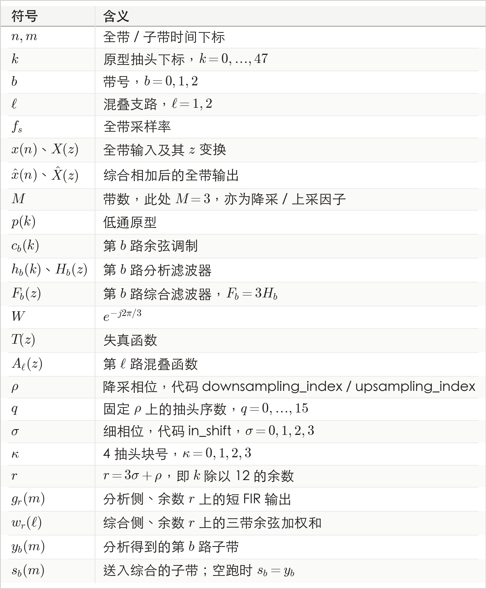
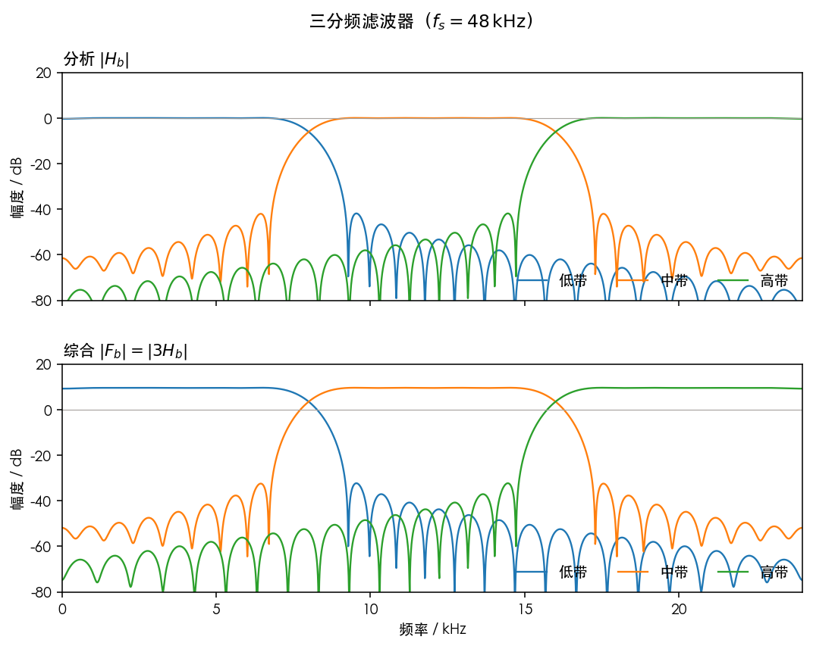
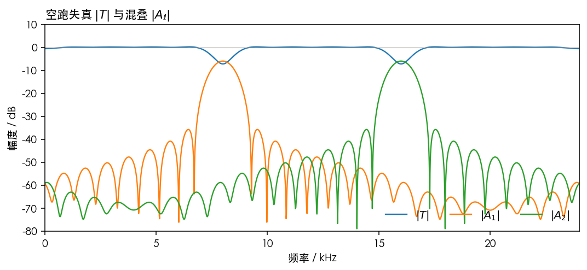
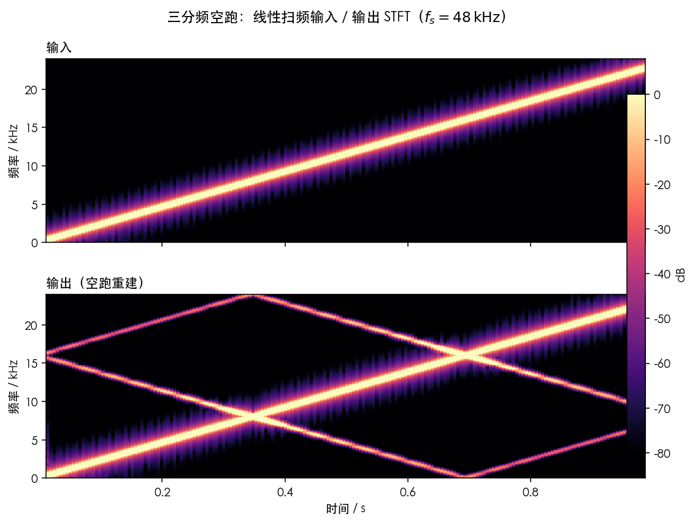
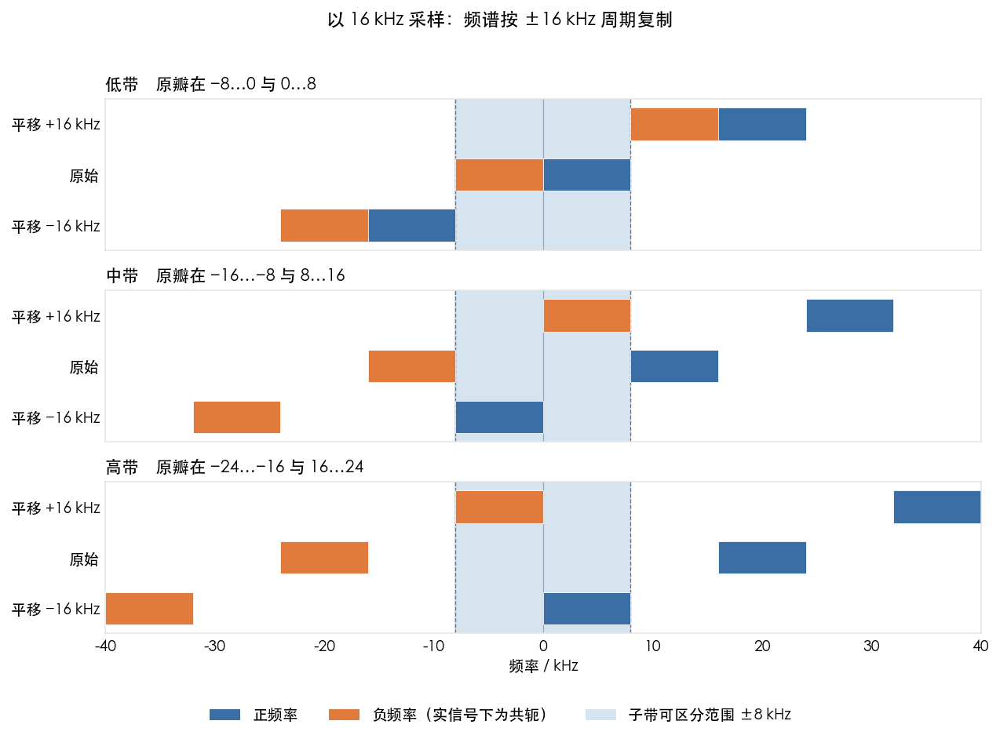

# 三分频 webrtc 版本

正如上一节所说，48 kHz 时 WebRTC 把 10 ms 全带拆成三分频带，入口是 `modules/audio_processing/three_band_filter_bank`。全带 480 点，分析后每带 160 点，带速率 16 kHz。

**全文符号表**



---

## 1. 数学模型

三分频分析综合原型其实和二分频一样，都是输入信号经过 3 个带通分析滤波器组，然后下采，经过子带处理后，上采，再经过带通综合滤波器组加和得到输出。

所以这里问题的关键在于两个点，一个是如何设计三分频滤波器组，一个是如何设计上下采算法。以下推导均照应 webrtc 算法代码以及使用的参数，以便于理解。

### 1.1 余弦调制设计带通滤波器组

三分频的带通滤波器，理想频域模型其实是一个低通滤波经过频域移位获得，而返回到时域，我们都知道频域移位等于时域调制，而频域移位使用的是单频信号卷积滤波器，照应到时域就是谐波信号乘上滤波器，也就是余弦调制。

带数 $M=3$。低通原型 $p(k)$ 长度 48，$k=0,\ldots,47$。第 $b$ 路分析滤波器是原型乘余弦：

$$
h_b(k)=p(k)\,c_b(k),\qquad
c_b(k)=2\cos\Big(\frac{2\pi k(2b+1)}{12}\Big),\qquad
b=0,1,2.
$$

余弦的中心在 $(2b+1)f_s/12$。$f_s=48\,\mathrm{kHz}$ 时是 4 / 12 / 20 kHz，名义通带 0–8 / 8–16 / 16–24 kHz。而综合滤波器的设计采用和 QMF 一样的逻辑，直接用同一组抽头，并乘上采样因子 3：

$$
F_b(z)=3H_b(z).
$$

代码里这个 3 是 `kUpsamplingScaling = kSubSampling`。

空跑（子带原样送回）时，输出由失真和两路混叠组成。$W=e^{-j 2\pi/3}$，

$$
\begin{aligned}
T(z)
&=\frac{1}{3}\sum_{b=0}^{2}F_b(z)\,H_b(z),\\[4pt]
A_{\ell}(z)
&=\frac{1}{3}\sum_{b=0}^{2}F_b(z)\,H_b(z W^{\ell}),\qquad \ell=1,2,\\[4pt]
\hat X(z)
&=T(z)\,X(z)+A_1(z)\,X(z W)+A_2(z)\,X(z W^{2}).
\end{aligned}
$$

$X(zW)$、$X(zW^2)$ 是平移 $f_s/3$、$2f_s/3$，在 48 kHz 上为 16 kHz、32 kHz。代入 $F_b=3H_b$，$1/3$ 与 3 相消：

$$
T(z)=\sum_{b=0}^{2}H_b(z)^2,\qquad
A_{\ell}(z)=\sum_{b=0}^{2}H_b(z)\,H_b(z W^{\ell}).
$$

实现注释写明调制方式接近 Harris《Multirate Signal Processing for Communication Systems》里的外差滤波器组。

### 1.2 上下采归并计算

webrtc 三分频的上下采其实仍然是多相滤波器组，但是我们看代码的时候会发现，实际上每次计算基础单元是 4 个点，如果是按照多相 3 倍计算，理论上应该是 $48 / 3 = 16$ 个点的计算单元。这里就是 webrtc 的巧妙之处，他利用了余弦调制的周期性，把余弦调制项合并提取出来，从而复用这部分计算结果，这里的余弦调制以 12 点为周期，3 分频之后 4 点单元处理，刚好对上余弦调制的周期。

全带卷积再按 3 降采：

$$
v_b(m)=\sum_{k=0}^{47} p(k)\,c_b(k)\,x(3m-k).
$$

代码取的是 $(h_b*x)(3m+2)$，相对上式整体平移 2 个全带样点。各带同一延迟时，$|T|$、$|A_\ell|$ 不变。

把抽头按降采相位拆开，$k=3q+\rho$，$\rho=0,1,2$，$q=0,\ldots,15$：

$$
v_b(m)
=\sum_{\rho=0}^{2}\sum_{q=0}^{15}
p(3q+\rho)\,c_b(3q+\rho)\,x\big(3(m-q)-\rho\big).
$$

$c_b(k)$ 对 $k$ 的周期是 12。固定 $\rho$ 时 $q$ 增加 4，下标增加 12，余弦回到原值，所以 $q$ 方向的周期是 4。再拆 $q=4\kappa+\sigma$，$r=3\sigma+\rho$：

- $\rho$：降采相位，代码里的 `downsampling_index`。
- $\sigma=0,1,2,3$：细相位，代码里的 `in_shift`。
- $\kappa=0,1,2,3$：这一细相位上的 4 个抽头。
- $r=3\sigma+\rho$：等于 $k \bmod 12$。代码里 `index = downsampling_index + in_shift * 3`。

余弦只依赖 $r$，所以内层与带号无关，可以单独提取出来：

$$
g_r(m)=\sum_{\kappa=0}^{3} p(12\kappa+r)\,x(3m-12\kappa-r),\qquad
v_b(m)=\sum_{r=0}^{11} c_b(r)\,g_r(m).
$$

$r=3$ 和 $r=9$ 上三带的余弦都是 0，这两路不用算。48 个抽头剩下 10 组、每组 4 个 $p(12\kappa+r)$。`kFilterCoeffs` 存这些抽头，`kDctModulation` 存对应的 $c_b(r)$。

分析读入的子序列是

$$
\texttt{in}[2-\rho+3k],\qquad k=0,\ldots,159.
$$

$\rho=0$ 读 $2,5,8,\ldots$，$\rho=1$ 读 $1,4,7,\ldots$，$\rho=2$ 读 $0,3,6,\ldots$。`FilterCore` 在这条带速率序列上做跨度 `kStride = 4` 的 4 抽头滤波，`in_shift` 选细相位。状态长度 `kMemorySize = 4\times 4-1 = 15`，每帧结束时留下该子序列最后 15 点。

综合先把三带用同一行余弦加起来，再走分析用过的那组短 FIR，最后乘 3 写回全带，带序列 $s_b(m)$ 同样采用空跑，因此就是 $y_b(m)$，对每个余数 $r$，

$$
w_r(\ell)=\sum_{b=0}^{2} c_b(r)\,s_b(\ell).
$$

$r=3,9$ 仍然跳过。滤波结果按相位 $\rho$ 写回：

$$
\hat x(\rho+3k)\ \text{累加}\ 3\,(\text{该相位各细相位的滤波输出}).
$$

代码的顺序是：`upsampling_index` 即 $\rho$，`in_shift` 即 $\sigma$，先做 $w_r$，再 `FilterCore`，然后

$$
\texttt{out}[\rho+3k]\mathrel{+}=3\cdot\texttt{out\_subsampled}[k].
$$

### 1.3 系数和频响

既然已经分析完了这个算法的原理和采用的技巧，现在来分析一下这个分析综合过程的重构性能。实现注释里的原型由下面这几行生成。$N=3\times 4\times 4-1=47$，

```text
h = fir1(N, 1 / (2 * kNumBands), kaiser(N + 1, 3.5));
reshape(h, 12, 4);
```

`fir1` 的截止是 $1/6$ Nyquist。48 kHz 上 Nyquist 为 24 kHz，截止在 4 kHz。Kaiser 的 $\alpha=3.5$，注释里用来把阻带压到 40 dB。`reshape` 之后丢掉全零的第 3、9 行，剩下的 10 行就是 `kFilterCoeffs`。

头文件给出的原型指标是：通带纹波 0.3 dB，通带频率 0.147（48 kHz 上 7 kHz），阻带衰减 40 dB，阻带频率 0.192（48 kHz 上 9.2 kHz），线性相位。单边延迟按

$$
kNumBands \times kSparsity \times kFilterSize / 2 = 24
$$

个样点计，48 kHz 上是 0.5 ms。

把 $p(k)c_b(k)$ 的频率响应画出来。分析通带贴着 0 dB，交叉在 8 kHz 和 16 kHz 附近。综合是同一条曲线加上 $20\log_{10} 3\approx 9.54\,\mathrm{dB}$。



再把 $T=\sum_b H_b^2$ 和 $A_\ell=\sum_b H_b(z)H_b(zW^\ell)$ 画在单位圆上。$|T|$ 从约 $-7.2\,\mathrm{dB}$ 到约 $+0.2\,\mathrm{dB}$，凹陷在两个交叉频率。$|A_\ell|$ 的峰值约 $-6.0\,\mathrm{dB}$，也在 8 kHz 和 16 kHz 附近。



可见在频带交叉点的混叠还是很严重的，实际上在设计过程中也可以看到，本质上只考虑了通带如何构造，但是没有考虑如何降低混叠与重构误差。

---

## 2. 实例

余弦可以手算。$c_b(0)=2$。$k=1$：

$$
\begin{aligned}
c_0(1)&=2\cos(\pi/6)=\sqrt{3},\\
c_1(1)&=2\cos(\pi/2)=0,\\
c_2(1)&=2\cos(5\pi/6)=-\sqrt{3}.
\end{aligned}
$$

$k=2$：

$$
\begin{aligned}
c_0(2)&=2\cos(\pi/3)=1,\\
c_1(2)&=2\cos(\pi)=-2,\\
c_2(2)&=2\cos(5\pi/3)=1.
\end{aligned}
$$

这三行就是 `kDctModulation` 的前三行：$\{2,2,2\}$、$\{\sqrt{3},0,-\sqrt{3}\}$、$\{1,-2,1\}$。$k=3$ 和 $k=9$：

$$
c_b(3)=2\cos\Big(\frac{\pi(2b+1)}{2}\Big)=0,\qquad
c_b(9)=2\cos\Big(\frac{3\pi(2b+1)}{2}\Big)=0.
$$

所以表里没有 $r=3,9$。

再用全 1 输入看零状态的第 0 点。状态为 0 时，`in_shift` $>0$ 的分支在第 0 点只乘到旧状态，贡献是 0。剩下 $\sigma=0$、$\rho=0,1,2$ 三支，每支 `FilterCore` 的第 0 点是子序列第 0 点乘上该行第 0 个抽头。全 1 输入时子序列第 0 点都是 1，于是

$$
y_b(0)=\sum_{\rho=0}^{2} c_b(\rho)\,p(\rho).
$$

三个抽头是 `kFilterCoeffs` 前三行的第 0 列：

$$
p(0)=-0.00047749,\quad
p(1)=-0.00173287,\quad
p(2)=-0.00304815.
$$

中带 $c_1(1)=0$，只剩两项：

$$
\begin{aligned}
y_1(0)
&=2p(0)-2p(2)\\
&=2(-0.00047749)-2(-0.00304815)\\
&=0.00514132.
\end{aligned}
$$

低带、高带把 $\sqrt{3}\,p(1)$ 加进去：

$$
\begin{aligned}
y_0(0)&=2p(0)+\sqrt{3}\,p(1)+p(2)=-0.00700455,\\
y_2(0)&=2p(0)-\sqrt{3}\,p(1)+p(2)=-0.00100171.
\end{aligned}
$$

`band3_chirp` 对全 1 的第一帧调用 `Analysis`，打印的 `ones0` 就是这三点。滤波器状态仍是 0，这是启动后的第 0 点。

---

## 3. 仿真

摘自 `modules/audio_processing/three_band_filter_bank.cc`，放在 `band3/`。`RTC_DCHECK` 换成了 `assert`。

### 3.1 函数对应的公式

`FilterCore` 是跨度 4 的 4 抽头 FIR。`in_shift` 决定从子序列的哪一个细相位开始乘 `filter[0]`。输出写满 160 点后，把输入最后 15 点抄进 `state`。

`Analysis` 对 $\rho=0,1,2$ 取出 `in[2-ρ+3k]`。对每个 $\sigma$ 计算 $r=\rho+3\sigma$，跳过 $r=3$ 和 $r=9$，其余用第 $r$ 行抽头和 `kDctModulation` 的对应行做滤波，再累加到三带：

$$
y_b(n)\mathrel{+}=c_b(r)\,g_r(n).
$$

`Synthesis` 先对同一 $r$ 做 $w_r(n)=\sum_b c_b(r)\,s_b(n)$，滤波之后乘 3，加到 `out[ρ+3k]`。分析状态和综合状态分开存，各 10 路、每路 15 点。`SplittingFilter` 在 48 kHz 上对每个通道持有一个 `ThreeBandFilterBank`，分析和综合走同一个对象。

### 3.2 仿真设计

采样率 $f_s=48\,\mathrm{kHz}$，时长 $1\,\mathrm{s}$，幅度 $0.8$。频率从 $100\,\mathrm{Hz}$ 线性升到 $23\,\mathrm{kHz}$。`sim/band3/band3_chirp.cc` 按 10 ms（480 点）分帧调用 `Analysis`，三带原样送回，再 `Synthesis`。状态跨帧保留。STFT、滤波器和 $T$、$A_\ell$ 由 `sim/band3/plot_chirp_stft.py` 画出。

### 3.3 仿真结果

输入和空跑输出的 STFT，色标 $[-80,0]\,\mathrm{dB}$。输出里除了跟着输入走的那条脊，还有 $f_s/3$、$2f_s/3$ 折回后的脊，在 8 kHz 附近交叉。这和上一节 $|A_\ell|$ 在 8 kHz、16 kHz 的峰是同一件事。



把输出相对输入平移后，误差能量最小的滞后是 46 个样点。这段扫频在该滞后上的信噪比是 $9.95\,\mathrm{dB}$。冲激响应的峰值也在第 46 个样点。头文件给的大约 9.5 dB 是随输入变化的量级，这次扫频落在附近。幅度均方根之比是 $0.970$。

## 4. 补充

### 4.1 性能算力分析

三分频没有二分频那样优雅的原始构造，而 webrtc 的设计方案给我的感觉却像是直接在二分频 QMF 的基础上向外延展，但是这样显然无法满足三分频完美重构的条件，设计过程中感觉也没有考虑重构误差问题，其实在考察代码的时候就可以想见，结果必然不太美好，最终的测试结果也确实如此，存在着比较大的误差。

实际上当前已经有了许多多分频重构算法，可以较好的压制混叠，提高平坦度，也许可以基于这些算法做变体优化三分频。

上下采的方法真的很巧妙，但是受限也十分严重，滤波器点数要满足要求，这直接导致了滤波器的设计受限，而子带分频的性能可以说完全取决于滤波器的设计本身。

在算力方面，这个实现和常规三相对比如下。同一只 48 点原型，一帧一个通道。$N$ 个乘积相加，计 $N$ 次乘、$N-1$ 次加。

| | 常规三相乘法（次） | 常规三相加法（次） | 本实现乘法（次） | 本实现加法（次） |
|--|--|--|--|--|
| 分析，每个带速率点 | 144 | 141 | 70 | 57 |
| 分析，每帧 | 23040 | 22560 | 11200 | 9120 |
| 综合，每帧 | 23040 | 22560 | 12800 | 9120 |
| 合计，每帧每通道 | 46080 | 45120 | 24000 | 18240 |

乘法大约是常规三相的一半，加法大约是四成。节省来自短 FIR 三带共用。

### 4.2 三相降采的混叠反折

不知道有没有人和我一样，刚学习子带算法的时候会不会好奇一个问题。以这里的 48 khz 三分频为例，降采到 16 khz，怎么可能保得住 16 -24 khz 的第三子带呢？

名义通带下（$H_0$ 保 0–8 kHz、$H_1$ 保 8–16 kHz、$H_2$ 保 16–24 kHz）滤波后的降采，我们近似认为是把某一带滤波后的连续谱按 16 kHz 抽样，等价于频谱与间隔 16 kHz 的冲激串卷积，在 $\pm 16\,\mathrm{kHz}$ 上周期复制。新采样可分辨的区间是阴影里的 $\pm 8\,\mathrm{kHz}$：



- **低带 $b=0$**：原瓣已在 $-8\ldots 0$ 与 $0\ldots 8$。$\pm 8$ kHz 以内只有原始瓣，0–8 kHz 仍是原来的正频率，方向不变。
- **中带 $b=1$（8–16 kHz 折进 0–8 kHz）**：原瓣在 $-16\ldots-8$ 与 $8\ldots 16$。负频瓣平移 $+16\,\mathrm{kHz}$ 进入 $0\ldots 8$，正频瓣平移 $-16\,\mathrm{kHz}$ 进入 $-8\ldots 0$。子带里方向反折：$f$ 落到 $16-f$（全带 12 kHz 落到子带 4 kHz）。
- **高带 $b=2$（16–24 kHz 折进 0–8 kHz）**：原瓣在 $-24\ldots-16$ 与 $16\ldots 24$。正频瓣平移 $-16\,\mathrm{kHz}$ 进入 $0\ldots 8$（$16\to 0$、$24\to 8$），负频瓣平移 $+16\,\mathrm{kHz}$ 进入 $-8\ldots 0$，方向不变。

这样就明白了，其实在 0 - 8 khz 得到的第二和第三子带是混叠反折的成分，如果滤波器严格满足理想条件，那么这个时候是不会发生混叠的，当然实际上不会存在这种完美的理想滤波器，所以混叠必须通过其他方法压制。

这也带来了一点启示，信号处理本质是信息论的应用，信息的精确度重要性远大于信息的位置。把频域每个频点视作一个位置，每个位置上放着不同颜色的水，有着不同的高度，我们把它打乱，那么问题来了，什么情况下我们可以复原原始的分布，什么情况下不行呢？这取决于打乱的方式，我们有很多方法可以记录位置，尤其是水的颜色和高度都不同，所以不同水杯位置换来换去根本无所谓的，不会影响我们的复原工作，但是如果不同水杯的水混在一起了，这个时候就很难复原了。而这里的操作在理想条件下就是交换位置的形式，尤其是后续 webrtc 3a 的算法几乎都是逐频点操作，在分析综合之后，各频点位置复原，自然就可以得到对应第二第三子带的处理结果。