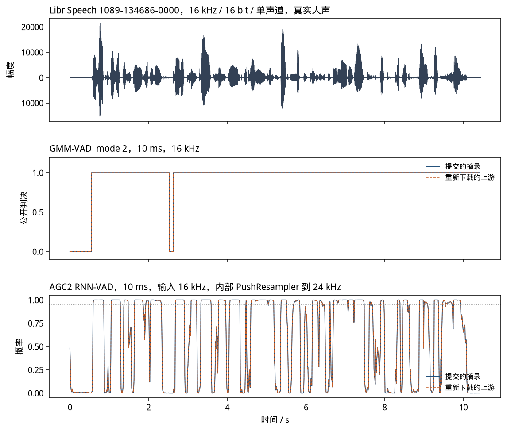
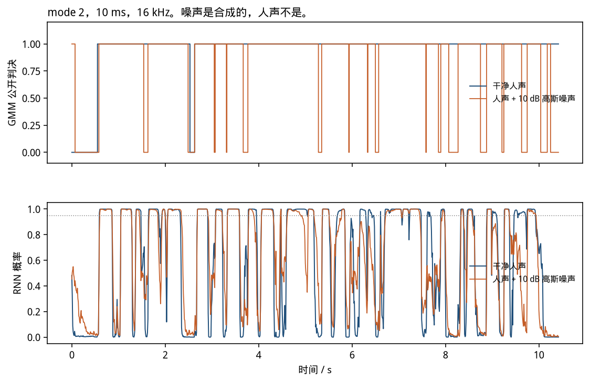
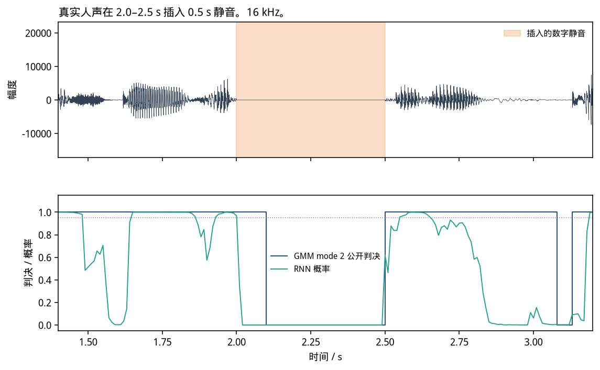
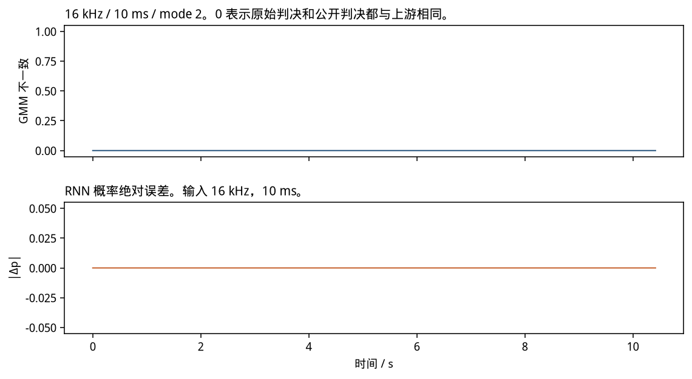

# GMM-VAD（common_audio/vad）

这是 WebRTC 对外的 `WebRtcVad_Process`。实现是定点 GMM，入口在 `common_audio/vad`。它不是 AGC2 的 RNN-VAD。AGC2 那一篇在 `doc/vad.md`。

对照提交是 WebRTC `eeb7e6beb2e20c5a273922fdf22b75a75cc28ad5`。可执行文件编的是这份源码，构建适配写在 `third_party/webrtc/ADAPTATIONS.md`。没有改高斯表、门限或滤波器系数。

合法采样率是 8 / 16 / 32 / 48 kHz，帧长是 10 / 20 / 30 ms。别的组合 `WebRtcVad_Process` 返回 -1。

ps:公式按 `vad_gmm.c`、`vad_filterbank.c`、`vad_core.c` 的定标写。

---

## 1. 数学模型

### 1.1 先变到 8 kHz

核心只在 8 kHz 上做。

- 16 kHz：`WebRtcVad_Downsampling`，全通一对，系数 Q15 为 0.64 和 0.17，再 2 倍抽取。
- 32 kHz：先 32→16，再 16→8，状态分开放。
- 48 kHz：`WebRtcSpl_Resample48khzTo8khz`，按 10 ms（480 点）一块，先降到 32 kHz 再降到 8 kHz。
- 8 kHz：直接进入特征。

### 1.2 六个子带的对数能量

8 kHz 信号先过高通。零点、极点是 Q14：

$$
b = (6631,\ -13262,\ 6631)/2^{14},\qquad
a \text{ 的反馈项来自 } (-7756,\ 5620)/2^{14}.
$$

注释写截止约 80 Hz（相对它内部那条 500 Hz 的低带）。然后用全通分裂出 6 个频带，名义上大约是 80–250、250–500、500–1000、1000–2000、2000–3000、3000–4000 Hz。每带能量做对数，常数是

$$
kLogConst = 24660 \approx 160\log_{10} 2 \quad (Q9).
$$

总能量低于 `kMinEnergy = 10` 时不做高斯更新。

### 1.3 两个高斯

每带语音、噪声各有两个高斯。均值和标准差初值是源码里的 Q7 表。对特征 $x$（Q4）、均值 $m$（Q7）、标准差 $s$（Q7），

$$
p(x)=\frac{1}{s}\exp\Big(-\frac{(x-m)^2}{2s^2}\Big),
$$

返回 Q20。实现里

$$
\frac{1}{s}\ \text{为 Q10 的}\ \frac{2^{17}+\lfloor s/2\rfloor}{s},
$$

指数用 $\log_2(e)\approx 5909/2^{12}$ 换成 `exp2`，再右移。同时给出

$$
\delta = (x-m)/s^2 \quad (Q11),
$$

语音帧用来推语音均值，非语音帧用来推噪声均值。均值有上下限，避免漂出表里的 `kMaximumSpeech`、`kMaximumNoise`。

每带两个高斯的概率按权重相加，得到该带的语音概率和噪声概率。全局判决看各带似然比的和，局部判决看单带。门限随 mode 0–3 变严，表是 `kLocalThresholdQ/LBR/AGG/VAG` 和 `kGlobalThreshold*`。mode 越大，越不容易报语音。

### 1.4 拖尾和两个输出

`GmmProbability` 的返回值不是只有 0/1。当前帧不像语音、但 `over_hang > 0` 时返回

$$
2 + \text{over\_hang},
$$

然后把拖尾减 1。连续语音把拖尾设成 `overhead1` 或 `overhead2`，长度也由 mode 决定。所以原始判决可以大于 1。

`WebRtcVad_Process` 在此之后做

$$
\text{public} = \begin{cases} 1, & \text{raw} > 0,\\ 0, & \text{raw} = 0,\\ -1, & \text{参数非法}. \end{cases}
$$

对齐时两列都比：原始返回值和这个公开 0/1。

---

## 2. 实例

全 0、16 kHz、10 ms、mode 0，100 帧。原始判决和公开判决都是 0。能量门没有打开。

同一段 16 kHz 真实语音（`speech/1089-134686-0000.wav`），10 ms，1043 帧。公开判决里被标成语音的帧数：

| mode | 0 | 1 | 2 | 3 |
|------|---|---|---|---|
| 帧数 | 1024 | 1024 | 978 | 887 |

mode 3 比 mode 0 少 137 帧。这是同一输入上的行为，不是检出率：语料没有逐帧真值。

非法采样率 22050 Hz 时两边进程都返回 2，不打判决。

---

## 3. 仿真

```bash
python3 sim/vad/align_vad.py
```

脚本重新下载上游，`diff -rq` 必须为空，再分别编译提交的摘录和这份新下载，用同一份 PCM 跑。原始判决或公开判决有一帧不同就非 0 退出。

真实语音、全 0、中间插入 0.5 s 数字静音、人声加 10 dB 高斯噪声，都覆盖了 10/20/30 ms 和 mode 0–3。8 kHz 是隔点抽取，32/48 kHz 是样点保持，只为走到对应的降采样分支；这两种都标明不是原始录音的采样率。8/48 kHz 再跑了 10 ms 和 30 ms、mode 0 和 3。

这次运行里，上面全部组合的原始判决不一致帧数是 0，公开判决不一致帧数也是 0。









图里的虚线是重新下载的上游。差图是 0。
