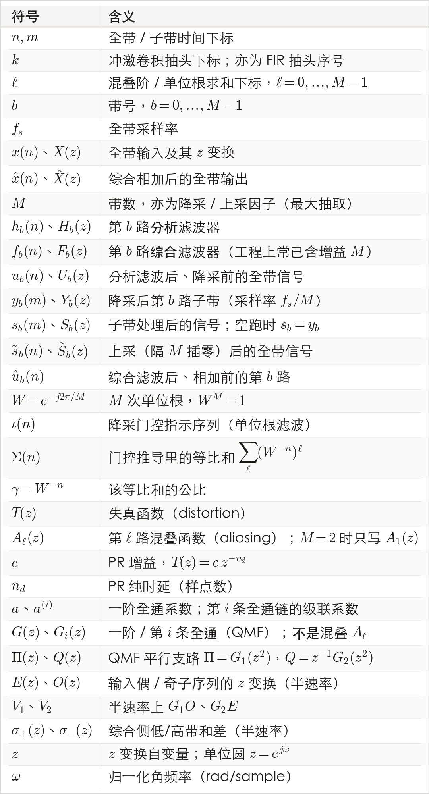
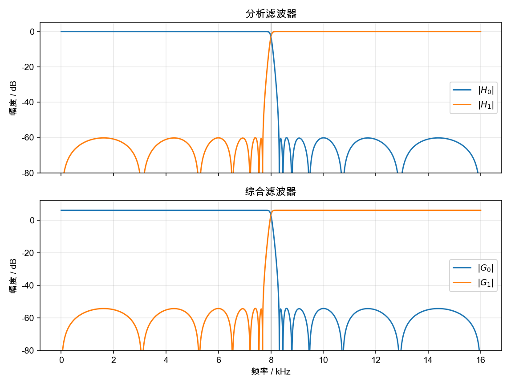
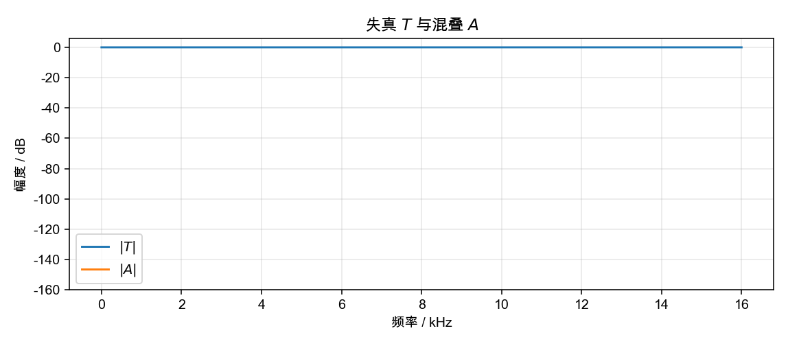
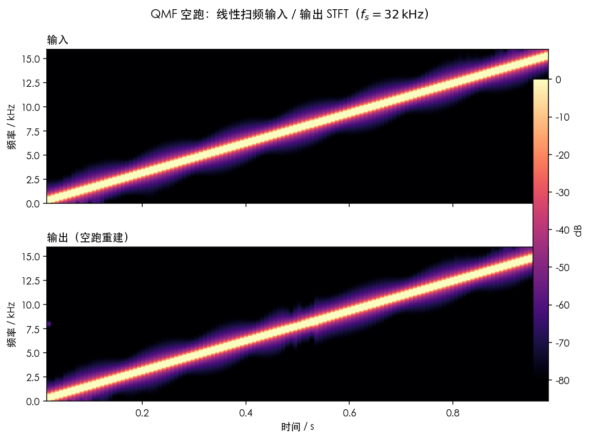

# QMF 二分频 webrtc 版本

按照上一节的 webrtc 3a 算法音频流来梳理，第一个有特殊处理的节点就是子带分析综合，webrtc 3a 算法核心工作在 16 khz 采样率，但是允许有 32 khz 和 48 khz 的输入，因此信号进入之后会根据采样率进行二分频以及三分频子带工作，本节讲的就是 webrtc 3a 的二分频处理方法。

实际生产中总会存在分频子带处理需求，而最为常用的场景就是二分频，二分频通常基于 QMF 滤波器组进行设计以实现完美重构，webrtc 3a 的二分频本质上就是采用的这个设计方法。

ps:公式推导只是按照自己的理解进行简化版的推导，也许并不严谨。

**全文符号表**

---

## 1. 数学模型

### 1.1 子带分析综合的完美重构条件

一次子带分析综合过程可以写成：输入 → 分析滤波 → 降采 $M$ →（子带处理）→ 上采 $M$ → 综合滤波 → 输出。输入是全频信号 $x(n)$，分析滤波器组由 $M$ 只滤波器并联构成，同一输入同时进入每一路，

$$
u_b(n)=\sum_{k} h_b(k)\,x(n-k),\qquad b=0,\ldots,M-1.
$$

转换到 $z$ 域

$$
U_b(z)=H_b(z)\,X(z).
$$

$H_b$ 的通带决定第 $b$ 路主要留下哪一段子带频谱。此时 $u_b$ 采样率不变。做 $M$ 点下采：

$$
y_b(m)=u_b(Mm).
$$

用 $M$ 个单位根把「每隔 $M$ 点留 1」写成门控。令

$$
\iota(n)=\frac{1}{M}\sum_{\ell=0}^{M-1} W^{-\ell n}.
$$

由于求和

$$
\Sigma(n)=\sum_{\ell=0}^{M-1}\big(W^{-n}\big)^{\ell}.
$$

是公比为 $\gamma=W^{-n}$ 的等比和。分两种情形：

- **$n=Mm$（被留下的时刻）。** $W^{-n}=(W^{M})^{-m}=1$，故每一项都是 1，$\Sigma(n)=M$，从而 $\iota(n)=1$。
- **$n\not\equiv 0\pmod{M}$（要丢掉的时刻）。** $\gamma=W^{-n}\neq 1$（$W$ 的阶恰为 $M$，只有 $M\mid n$ 时 $\gamma=1$）。等比和公式

$$
\Sigma(n)=\frac{1-\gamma^{M}}{1-\gamma}.
$$

分子里 $\gamma^{M}=W^{-nM}=(W^{M})^{-n}=1$，故 $1-\gamma^{M}=0$，而分母 $1-\gamma\neq 0$，于是 $\Sigma(n)=0$，从而 $\iota(n)=0$。

所以这实际上是抽取函数

$$
\iota(n)=
\begin{cases}
1, & n=Mm,\\
0, & \text{其余 } n.
\end{cases}
$$

被保留的序列是 $u_b(n)\,\iota(n)$。抽取目标点后下采去除置 0 点，只在 $n=Mm$ 上求和：

$$
\begin{aligned}
Y_b(z)
&=\sum_{m}u_b(Mm)\,z^{-m}
=\sum_{n}u_b(n)\,\iota(n)\,(z^{1/M})^{-n}\\
&=\frac{1}{M}\sum_{\ell=0}^{M-1}\sum_{n}u_b(n)\,(z^{1/M}W^{\ell})^{-n}
=\frac{1}{M}\sum_{\ell=0}^{M-1}U_b\big(z^{1/M}W^{\ell}\big).
\end{aligned}
$$

代入 $U_b=H_b X$：

$$
Y_b(z)
=\frac{1}{M}\sum_{\ell=0}^{M-1}
H_b\big(z^{1/M}W^{\ell}\big)\,
X\big(z^{1/M}W^{\ell}\big).
$$

$z=e^{j\omega}$ 时，$W^{\ell}$ 把全带频率平移 $\ell\cdot f_s/M$。z 域上面公式推导看着很复杂，但是其实就是下采导致的频域混叠，可以将频域的混叠理解为恢复原始连续信号后的再次采样，采样序列本质上是频域的单位序列，所以会以多带下采的间隔在 z 域的映射为单位进行卷积，将滤波后的频段平移重构。实际上部分子带就是通过这份混叠逻辑落到低频处的，从这里也可以看出，分析综合过程会受到混叠的影响，严重程度取决于滤波器组的设计。

因为只考察分析 + 综合能不能把 $x$ 恢复，所以我们令

$$
s_b(m)=y_b(m),\qquad S_b(z)=Y_b(z).
$$

每路在相邻样点之间补 $M-1$ 个 0 做插值上采，时间拉开 $M$ 倍。$S_b(z)$ 里的 $z^{-m}$ 变成 $z^{-Mm}$，自变量换成 $z^M$：

$$
\tilde S_b(z)=S_b(z^M).
$$

用 $S_b=Y_b$ 和降采公式，

$$
\begin{aligned}
\tilde S_b(z)
&=Y_b(z^M)
=\frac{1}{M}\sum_{\ell=0}^{M-1}
H_b(z W^{\ell})\,X(z W^{\ell}).
\end{aligned}
$$

补零把降采叠在一起的 $M$ 份频谱又铺回全频，所以每一路上采结果里同时有 $X(z)$、$X(zW)$、…、$X(zW^{M-1})$。

上采之后的 $M$ 路各过一只综合滤波器，再相加：

$$
\begin{aligned}
\hat u_b(n)&=\sum_{k} f_b(k)\,\tilde s_b(n-k),\\
\hat x(n)&=\sum_{b=0}^{M-1}\hat u_b(n).
\end{aligned}
$$

$z$ 域

$$
\hat X(z)=\sum_{b=0}^{M-1}F_b(z)\,\tilde S_b(z).
$$

代入 $\tilde S_b$，并交换求和次序

$$
\begin{aligned}
\hat X(z)
&=\sum_{b=0}^{M-1}F_b(z)\cdot\frac{1}{M}\sum_{\ell=0}^{M-1}
H_b(z W^{\ell})\,X(z W^{\ell})\\
&=\frac{1}{M}\sum_{\ell=0}^{M-1}X(z W^{\ell})
\sum_{b=0}^{M-1}F_b(z)\,H_b(z W^{\ell}).
\end{aligned}
$$

这就是 $M$ 带滤波器组的分析综合关系，可以将输出理解为 $M$ 个「平移后的输入」的线性组合，每个平移各带一个权重 $\sum_b F_b(z)H_b(zW^{\ell})$。

把 $\ell=0$ 与 $\ell=1,\ldots,M-1$ 分开写。定义

$$
\begin{aligned}
T(z)
&=\frac{1}{M}\sum_{b=0}^{M-1}F_b(z)\,H_b(z),\\[4pt]
A_{\ell}(z)
&=\frac{1}{M}\sum_{b=0}^{M-1}F_b(z)\,H_b(z W^{\ell}),
\qquad \ell=1,\ldots,M-1.
\end{aligned}
$$

则

$$
\hat X(z)=T(z)\,X(z)+\sum_{\ell=1}^{M-1}A_{\ell}(z)\,X(z W^{\ell}).
$$

- $T(z)$：**失真函数**（distortion）。它乘在未平移的 $X(z)$ 上。若 $T(z)=c\,z^{-n_d}$（$c\neq 0$），则输出只是输入的增益与延迟，称为**准确重建 / 完美重构（PR）**。若只要求 $|T(e^{j\omega})|$ 近似常数，是**近似幅度重建**；相位仍可能非线性。但是在语音领域如果不追求完美的听觉重构，相位的要求没有那么高，重要的还是幅值的平坦度。
- $A_{\ell}(z)$：这里就是**第 $\ell$ 路混叠函数**（aliasing），是上下采产生的混叠效应的公式体现。转到频域，$X(zW^{\ell})$ 是频谱平移了 $\ell\cdot f_s/M$ 的副本；系数不为 0 时，混叠的能量会漏回输出。注意这里的混叠项数量和带数关联，但是每一项在连续域上有无穷平移条目。

要混叠消失，最严格的条件须

$$
A_{\ell}(z)=0,\qquad \ell=1,\ldots,M-1
$$

混叠消掉之后 $\hat X(z)=T(z)X(z)$；再令 $T(z)=c\,z^{-n_d}$ 即 PR。但实际上几乎不可能做到每一项都为 0，所以在很多构造技巧中会尝试让加和尽可能的趋近于 0，也就是各项尽可能通过相位互相抵消。

### 1.2 QMF 推导与 WebRTC 两带实现

两带是 §1.1 中 $M=2$ 的特例。取 $M=2$，则 $W=e^{-j\pi}=-1$，因此只剩一项混叠：

$$
\begin{aligned}
T(z)
&=\frac{1}{2}\Big(F_0(z)\,H_0(z)+F_1(z)\,H_1(z)\Big),\\[4pt]
A_1(z)
&=\frac{1}{2}\Big(F_0(z)\,H_0(-z)+F_1(z)\,H_1(-z)\Big),\\[4pt]
\hat X(z)
&=T(z)\,X(z)+A_1(z)\,X(-z).
\end{aligned}
$$

混叠抵消要求 $A_1(z)=0$，即

$$
F_0(z)\,H_0(-z)+F_1(z)\,H_1(-z)=0.
$$

完美重构还要求 $T(z)=c\,z^{-n_d}$（$c\neq 0$）；在频域即 $T(e^{j\omega})=c\,e^{-j\omega n_d}$，幅度为常数且相位对 $\omega$ 线性（线性相位）。仅 $|T|$ 平坦是近似幅度重建，相位仍可能非线性。

基于此我们可以得到一组经典的完美重构解，即 QMF 滤波器组

$$
H_1(z)=-H_0(-z),\qquad
F_0(z)=2H_0(z),\qquad
F_1(z)=-2H_1(z).
$$

代回后混叠恒为 0。webrtc采用全通构造这个滤波器组，现有全通 iir 滤波器，每一级递推

$$
y(n)=x(n-1)+a\big(x(n)-y(n-1)\big),\qquad |a|<1.
$$

移项得

$$
y(n)+a\,y(n-1)=a\,x(n)+x(n-1).
$$

零状态下 $z$ 变换：

$$
Y(z)\big(1+a z^{-1}\big)=X(z)\big(a+z^{-1}\big)
\quad\Rightarrow\quad
G(z)=\frac{a+z^{-1}}{1+a\,z^{-1}}.
$$

单位圆上 $|a+e^{-j\omega}|^2=|1+a e^{-j\omega}|^2=1+2a\cos\omega+a^2$，故 $|G(e^{j\omega})|=1$；又 $G(1)=1$。只改相位、不改幅度，并且只需要 1 个系数即可表达滤波器本身。

如何通过全通滤波器得到高低通滤波器此处不做推导，详见参考资料：Vaidyanathan《Multirate Systems and Filter Banks》里平行全通功率互补结构；Regalia / Mitra / Vaidyanathan, “The digital all-pass filter: A versatile signal processing building block,” Proc. IEEE, 1988，这里只对结论进行分析，构造

$$
\begin{aligned}
\Pi(z)&=G_1(z^2),\\
Q(z)&=z^{-1}G_2(z^2),\\
H_0(z)&=\frac{1}{2}\big(\Pi(z)+Q(z)\big)
=\frac{1}{2}\Big(G_1(z^2)+z^{-1}G_2(z^2)\Big),\\
H_1(z)&=\frac{1}{2}\big(\Pi(z)-Q(z)\big)
=\frac{1}{2}\Big(G_1(z^2)-z^{-1}G_2(z^2)\Big).
\end{aligned}
$$

在单位圆 $z=e^{j\omega}$ 上，$|G_1(e^{j2\omega})|=|G_2(e^{j2\omega})|=1$，且 $|e^{-j\omega}|=1$，故 $|\Pi|=|Q|=1$。于是

$$
\begin{aligned}
\big|H_0(e^{j\omega})\big|^2+\big|H_1(e^{j\omega})\big|^2
&=\frac{1}{4}\Big(|\Pi+Q|^2+|\Pi-Q|^2\Big)
=\frac{1}{4}\big(2|\Pi|^2+2|Q|^2\big)
=1.
\end{aligned}
$$

所以这个滤波器组功率互补。一阶节 $G(z)=(a+z^{-1})/(1+a z^{-1})$ 满足 $G(1)=1$，级联后 $G_1(1)=G_2(1)=1$。

- 直流 $z=1$（0 频）：$\Pi(1)=G_1(1)=1$，$Q(1)=1\cdot G_2(1)=1$，故
  $$
  H_0(1)=\frac{1}{2}(1+1)=1,\qquad
  H_1(1)=\frac{1}{2}(1-1)=0.
  $$
- 奈奎斯特 $z=-1$：$\Pi(-1)=G_1((-1)^2)=G_1(1)=1$，$Q(-1)=(-1)G_2(1)=-1$，故
  $$
  H_0(-1)=\frac{1}{2}(1-1)=0,\qquad
  H_1(-1)=\frac{1}{2}\big(1-(-1)\big)=1.
  $$

因此 $H_0$ 直流通、奈奎斯特止，$H_1$ 相反，分别为低通与高通，至此获得了满足要求的高低通滤波器组。当然这里只是很粗暴的验算，正向推导还是建议去查阅参考资料。

二分频的原型是高低通滤波过后下采获得二分频信号，而 webrtc 则从这个角度出发经过巧妙的滤波器设计与算法技巧减少了内存和算力的消耗。

将输入分为奇偶序列，使用上面设计的低通滤波器 $H_0 X$ 进行滤波得到

$$
\begin{aligned}
H_0(z)\,X(z)
&=\frac{1}{2}\Big(G_1(z^2)+z^{-1}G_2(z^2)\Big)
\Big(E(z^2)+z^{-1}O(z^2)\Big)\\
&=\frac{1}{2}\Big[
G_1(z^2)\,E(z^2)
+z^{-1}G_1(z^2)\,O(z^2)
+z^{-1}G_2(z^2)\,E(z^2)
+z^{-2}G_2(z^2)\,O(z^2)
\Big].
\end{aligned}
$$

按偶次幂 / 奇次幂（偶数时刻 / 奇数时刻）分开：

- 偶数时刻（无单独 $z^{-1}$）：
  $\displaystyle
  \frac{1}{2}\Big(G_1(z^2)\,E(z^2)+z^{-2}G_2(z^2)\,O(z^2)\Big)$。  
- 奇数时刻（恰好一个 $z^{-1}$）：
  $\displaystyle
  \frac{z^{-1}}{2}\Big(G_1(z^2)\,O(z^2)+G_2(z^2)\,E(z^2)\Big)$。

然后进行下采，取分析输出的奇数时刻 $n=2m+1$，得到

$$
Y_0(z)=\frac{1}{2}\big(G_1(z)\,O(z)+G_2(z)\,E(z)\big).
$$

webrtc 实现上先算 $V_1=G_1 O$、$V_2=G_2 E$，再 $Y_0=\frac12(V_1+V_2)$。对前面已定义的 $H_1$ 同样展开 $H_1 X$ 进行滤波，奇数时刻系数为

$$
\frac{z^{-1}}{2}\Big(G_1(z^2)\,O(z^2)-G_2(z^2)\,E(z^2)\Big),
$$

下采后得到

$$
Y_1(z)=\frac{1}{2}\big(G_1(z)\,O(z)-G_2(z)\,E(z)\big)
=\frac{1}{2}(V_1-V_2).
$$

配套综合取与第一部分同形 $F_0=2H_0$、$F_1=-2H_1$，即

$$
\begin{aligned}
F_0(z)&=G_1(z^2)+z^{-1}G_2(z^2),\\[4pt]
F_1(z)&=-G_1(z^2)+z^{-1}G_2(z^2).
\end{aligned}
$$

不对子带做信号处理，令 $S_b=Y_b$。上采后两路为 $Y_0(z^2)$、$Y_1(z^2)$，综合输出

$$
\hat X(z)=F_0(z)\,Y_0(z^2)+F_1(z)\,Y_1(z^2).
$$

把 $F_0$、$F_1$ 代进去并按 $G_1(z^2)$、$z^{-1}G_2(z^2)$ 归项：

$$
\begin{aligned}
\hat X(z)
&=G_1(z^2)\big(Y_0(z^2)-Y_1(z^2)\big)
+z^{-1}G_2(z^2)\big(Y_0(z^2)+Y_1(z^2)\big).
\end{aligned}
$$

分析里已有 $Y_0=\frac12(V_1+V_2)$、$Y_1=\frac12(V_1-V_2)$，故半速率上的和差刚好抵消 $\frac12$：

$$
\begin{aligned}
\sigma_+(z)&=Y_0(z)+Y_1(z)=V_1(z)=G_1(z)\,O(z),\\
\sigma_-(z)&=Y_0(z)-Y_1(z)=V_2(z)=G_2(z)\,E(z).
\end{aligned}
$$

于是

$$
\hat X(z)=G_1(z^2)\,\sigma_-(z^2)+z^{-1}G_2(z^2)\,\sigma_+(z^2).
$$

第一项只含 $z$ 的偶次幂，对应偶数时刻；第二项带单个 $z^{-1}$，对应奇数时刻。因此实现上：先对低/高带做和差得到 $\sigma_+$、$\sigma_-$，再**交换**两条全通链——$\sigma_+$ 过 $G_2$ 写回奇数点，$\sigma_-$ 过 $G_1$ 写回偶数点——与上式一致。这就是 webrtc 所采用的和差算法，本质上其实是基于特殊的滤波器特性进行二分频 QMF 简化。

至此分析 / 综合滤波器组 $\{H_0,H_1,F_0,F_1\}$ 已定。二分频的失真与混叠分别为

$$
\begin{aligned}
T(z)
&=\frac{1}{2}\Big(F_0(z)\,H_0(z)+F_1(z)\,H_1(z)\Big),\\[4pt]
A_1(z)
&=\frac{1}{2}\Big(F_0(z)\,H_0(-z)+F_1(z)\,H_1(-z)\Big).
\end{aligned}
$$

代入第一部分：$A_1(z)=0$，且

$$
T(z)=H_0(z)^2-H_1(z)^2=z^{-1}G_1(z^2)G_2(z^2),
$$

故 $|T(e^{j\omega})|=1$（$T$ 为全通，非有限阶纯时延）。

webrtc 采用 3 级级联全通滤波器。现行 `splitting_filter.c` 把系数存成 `float`，运算也是浮点；这组数来自旧版同一文件的 Q16 定点表（`uint16`，1.0 对应 $2^{16}=65536$）：

$$
a^{(1)}_{\mathrm{Q16}}=(6418,\ 36982,\ 57261),\qquad
a^{(2)}_{\mathrm{Q16}}=(21333,\ 49062,\ 63010).
$$

定点转浮点就是除以 $2^{16}$。旧实现里系数是 Q16、样点是 Q10，乘完右移 16 位，等价于乘 $a_{\mathrm{Q16}}/65536$：

$$
a=\frac{a_{\mathrm{Q16}}}{65536}.
$$

除完再收成 `float32`，与源码里的浮点字面量逐比特相同：

$$
\begin{aligned}
a^{(1)} &= (0.0979309082,\ 0.5643005371,\ 0.8737335205)
&&\text{（支路 $G_1$）},\\
a^{(2)} &= (0.3255157471,\ 0.7486267090,\ 0.9614562988)
&&\text{（支路 $G_2$）}.
\end{aligned}
$$

用这组系数在 $f_s=32\,\mathrm{kHz}$ 上画 $|H_b|$、$|F_b|$、$|T|$、$|A_1|$：8 kHz 处分界约 $-3.01\,\mathrm{dB}$；通带内 $|F_b|=2|H_b|$；直流 $H_0\approx 1$、$H_1\approx 0$；奈奎斯特相反；$|T|$ 贴 0 dB，$|A_1|$ 约 $10^{-13}$。

可见理论误差非常小。

## 2. 实例

手算只留 1 级全通，递推与 `WebRtcSpl_AllPassQMF` 的每一级相同。webrtc 是把这一级再级联 3 次，系数用 §1.2 的 $a^{(1)}$、$a^{(2)}$。这里取

$$
\begin{aligned}
a^{(1)} &= \tfrac12 &&\text{（支路 $G_1$，奇数点）},\\
a^{(2)} &= \tfrac14 &&\text{（支路 $G_2$，偶数点）}.
\end{aligned}
$$

状态全 0。输入 4 点

$$
x(n): 1,\;1,\;1,\;1 \qquad n=0,1,2,3.
$$

递推 $y(n)=x(n-1)+a\big(x(n)-y(n-1)\big)$，缺的历史当 0。

**分析。** 奇数点 $1,1$ 进 $G_1$，偶数点 $1,1$ 进 $G_2$。

$$
\begin{aligned}
f_1(0)&=0+\tfrac12(1-0)=\tfrac12,\\
f_1(1)&=1+\tfrac12\big(1-\tfrac12\big)=\tfrac54,\\[4pt]
f_2(0)&=\tfrac14,\\
f_2(1)&=1+\tfrac14\big(1-\tfrac14\big)=\tfrac{19}{16}.
\end{aligned}
$$

$$
\begin{aligned}
\mathrm{low}&=\tfrac12(f_1+f_2)=\big(\tfrac38,\;\tfrac{39}{32}\big),\\
\mathrm{high}&=\tfrac12(f_1-f_2)=\big(\tfrac18,\;\tfrac{1}{32}\big).
\end{aligned}
$$

**综合。** 和差把前面的 $\tfrac12$ 抵消掉，两条链对调：

$$
\begin{aligned}
\mathrm{low}+\mathrm{high}&=f_1=\big(\tfrac12,\;\tfrac54\big)
&&\text{进 $G_2$，写奇数点},\\
\mathrm{low}-\mathrm{high}&=f_2=\big(\tfrac14,\;\tfrac{19}{16}\big)
&&\text{进 $G_1$，写偶数点}.
\end{aligned}
$$

$$
\begin{aligned}
\hat x(0)&=\tfrac12\cdot\tfrac14=\tfrac18,\\
\hat x(1)&=\tfrac14\cdot\tfrac12=\tfrac18,\\
\hat x(2)&=\tfrac14+\tfrac12\big(\tfrac{19}{16}-\tfrac18\big)=\tfrac{25}{32},\\
\hat x(3)&=\tfrac12+\tfrac14\big(\tfrac54-\tfrac18\big)=\tfrac{25}{32}.
\end{aligned}
$$

所以

$$
\hat x(n):\ \tfrac18,\;\tfrac18,\;\tfrac{25}{32},\;\tfrac{25}{32}.
$$

这 4 点是 $T(z)=z^{-1}G_1(z^2)G_2(z^2)$ 刚启动时的输出，全通记忆还在建立。

## 3. 仿真

码仓为https://github.com/liang-nian/webrtc_3a.git，实际上就是摘取的 webrtc 代码做仿真，可以直接去看 webrtc 的源码。

### 3.1 函数对应的公式

`WebRtcSpl_AllPassQMF` 把三节一阶全通串起来。状态 6 个数，每节两个：输入的 $x[-1]$ 和该节输出的 $y[-1]$。系数表 `WebRtcSpl_kAllPassFilter1` 是 $G_1$，`WebRtcSpl_kAllPassFilter2` 是 $G_2$。

`WebRtcSpl_AnalysisQMF` 把全带按奇偶拆开。`half_in2[i] = in_data[2i]` 是偶数点，走 $G_2$，状态是 `filter_state2`。`half_in1[i] = in_data[2i+1]` 是奇数点，走 $G_1$，状态是 `filter_state1`。两路输出记 `filter1`、$f_1$ 和 `filter2`、$f_2$，

$$
\begin{aligned}
\mathrm{low\_band}&=\tfrac12(f_1+f_2),\\
\mathrm{high\_band}&=\tfrac12(f_1-f_2).
\end{aligned}
$$

留下的是滤波后的奇数点，所以

$$
H_0(z)=\tfrac12\big(G_1(z^2)+z^{-1}G_2(z^2)\big),\qquad
H_1(z)=\tfrac12\big(G_1(z^2)-z^{-1}G_2(z^2)\big).
$$

`WebRtcSpl_SynthesisQMF` 先做和差。`half_in1 = low + high` 走 $G_2$，写出奇数时刻；`half_in2 = low - high` 走 $G_1$，写出偶数时刻。两条系数表和状态相对分析对调。写出的序列在限幅到 $[-32768, 32767]$ 之前是

$$
F_0(z)=G_1(z^2)+z^{-1}G_2(z^2)=2H_0(z),\qquad
F_1(z)=-G_1(z^2)+z^{-1}G_2(z^2)=-2H_1(z).
$$

空跑、且样点没有顶到这个限幅时，$T(z)=z^{-1}G_1(z^2)G_2(z^2)$，$A_1(z)=0$。

### 3.2 仿真设计

采样率 $f_s=32\,\mathrm{kHz}$，时长 $1\,\mathrm{s}$，幅度 $0.8$。频率从 $100\,\mathrm{Hz}$ 线性升到 $15.5\,\mathrm{kHz}$。`sim/qmf/qmf_chirp.cc` 按 10 ms（320 点）分帧调用 `WebRtcSpl_AnalysisQMF`，子带原样送回，再 `WebRtcSpl_SynthesisQMF`。分析、综合各自的 6 点状态跨帧保留。STFT 由 `sim/qmf/plot_chirp_stft.py` 画出。

### 3.3 仿真结果

输入和空跑输出的 STFT，色标 $[-80,0]\,\mathrm{dB}$。输出的扫频脊跟着输入走，8 kHz 分界附近没有另起一条混叠脊。$|T|$ 贴 0 dB，这条脊的强弱和输入一致。

重构效果十分完美。

## 4. 补充

QMF 滤波器组十分经典，也十分符合算法美学，简单而和谐，本身实在没有太多可说的内容，但是 webrtc 这里的滤波器组设计和和差算法很有趣，所以摘出来分析一下。其本质仍然是普通的 QMF 二分频算法，但是充分利用了滤波器的特殊性，在 webrtc 中 3a 算法的核心工作频率是 16 khz，二分频用在 32 khz 采样率上面，由于每块 10 ms，所以最大块点数设置为 320 点，如果是48 khz 就需要三分频，这个时候问题就会复杂非常多。