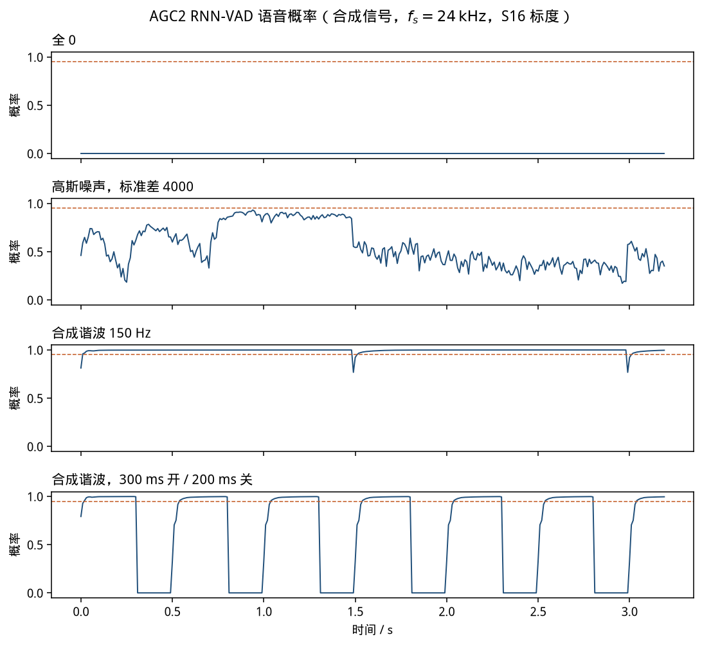
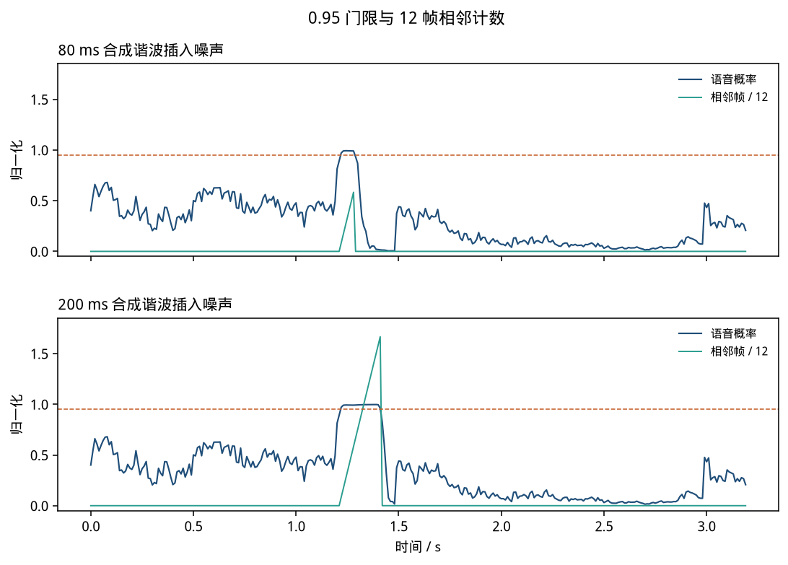
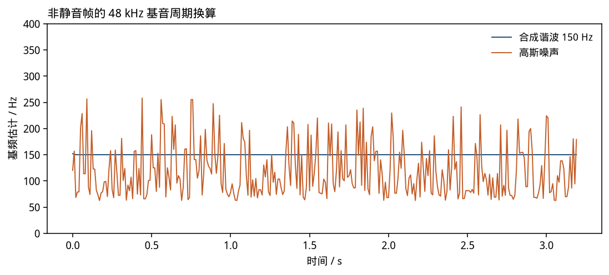

# AGC2 RNN-VAD

48 kHz 的捕获链路在合带之后把 10 ms 全带交给 AGC2。本篇只解析这一处用到的语音活动检测：`modules/audio_processing/agc2/rnn_vad`，外加 `vad_wrapper` 和消费概率的三处状态更新。对照的 WebRTC 提交是 `eeb7e6beb2e20c5a273922fdf22b75a75cc28ad5`（2026-11-07）。权重表来自 Chromium `third_party/rnnoise` 提交 `63d42f6e6a54c9463fcb599001ca81ff2fd3dc8e`，README.chromium 写明 RNNoise 基线是 `91ef401f4c3536c6de999ac609262691ec888c4c`（BSD-3-Clause，Jean-Marc Valin / Xiph），int8 量化表是 WebRTC 的本地修改。

同一棵树里还有两类名字也叫 VAD 的东西，本篇不实现它们：

| 位置 | 是什么 | 和本篇的关系 |
|------|--------|----------------|
| `common_audio/vad` | 定点 GMM，`WebRtcVad_Process`，8/16/32/48 kHz，10/20/30 ms | 公开 API 和旧代码。不是 AGC2 的默认检测器 |
| `modules/audio_processing/vad` | 基音 + GMM，给 AGC1 | `AudioProcessingImpl` 在本提交里构造 AGC2 时写死 `use_internal_vad=true`，不走这条 |
| `agc2/rnn_vad` | 24 kHz 特征 + 全连接 + GRU | 本篇 |

`doc/webrtc_3a.md` 里「无 NS 时自带、有 NS 时可复用」说的是更早的接法。本提交的 `GainController2::Process` 只在内部 `vad_` 存在时调用 `Analyze`，没有从噪声抑制器读语音概率。NS 自己的语音概率是另一件事。

`speech_probability_buffer` 编进了 `input_volume_controller` 这个构建目标，单元测试也在，但 `GainController2::Process` 和 `MonoInputVolumeController::Process` 都没有调用它。下面只把它当作一份对照过测试数字的旁路公式，不放进仿真曲线。

ps:公式按源码的运算顺序写，省掉了 SIMD 分支。

**符号**

| 符号 | 含义 |
|------|------|
| $x(n)$ | 24 kHz、S16 标度的 float。满幅正弦大约是 $\pm 32768$，不是 $[-1,1]$ |
| $N_{10}, N_{20}$ | 240、480，即 10 ms、20 ms |
| $T_{48}$ | 基音周期，单位是 48 kHz 上的样点 |
| $\mathbf{f}\in\mathbb{R}^{42}$ | 送进 RNN 的特征 |
| $p$ | RNN 输出的语音概率，静音门打开时强制为 0 |
| $a_j$ | 5 阶 LPC 系数，$j=0,\ldots,4$ |

---

## 1. 数学模型

### 1.1 帧从哪来

`VoiceActivityDetectorWrapper` 每 10 ms 做三件事：

1. 倒数计数。初值 $1500/10=150$。减到 0 就 `RnnVad::Reset()`，只清 GRU 状态，特征缓冲不动，然后把计数拨回 150。
2. 只取第一声道，用 `PushResampler` 变到 24 kHz，得到 240 点。本仓库的仿真不包含这只重采样器，调用方直接给 24 kHz。
3. `FeaturesExtractor::CheckSilenceComputeFeatures`，再 `RnnVad::ComputeVadProbability`。

高通写在特征提取器里，系数是 24 kHz 上 60 Hz 的 2 阶 Butterworth，但构造函数把 `use_high_pass_filter_` 设成 `false`。当前这条路径不过高通。APM 前面已有独立的高通，见 `doc/webrtc_3a.md` §2.2。

### 1.2 基音缓冲和 LPC

240 点推进长度 $kBufSize24kHz = 384+480 = 864$ 的缓冲。384 是 24 kHz 上的最长基音（$24000/62.5$），480 是分析帧。

对这 864 点做自相关 $r(\ell)=\sum_n x(n)x(n+\ell)$，$\ell=0,\ldots,4$。$r(0)=0$ 时系数全 0。否则按源码做两步预处理：

$$
r(0)\leftarrow 1.0001\,r(0),\qquad
r(\ell)\leftarrow r(\ell)\big(1-(0.008\ell)^2\big),\quad \ell=1,\ldots,4.
$$

后面是 Levinson 递推。反射系数

$$
k_i=-\frac{r(i+1)+\sum_{j=0}^{i-1}a_j r(i-j)}{e},
$$

$|e|<10^{-6}$ 时把 $e$ 拉到这个幅度并保留符号。$e<0.001\,r(0)$ 就停。递推完再乘 $0.9^{j+1}$，然后做一次

$$
\begin{aligned}
a'_0 &= 0.9\,a_0+0.8,\\
a'_j &= 0.9^{j+1}a_j+0.8\cdot 0.9^{j}a_{j-1},\quad j=1,2,3,\\
a'_4 &= 0.8\cdot 0.9^{4}a_3.
\end{aligned}
$$

残差是

$$
e(n)=x(n)+\sum_{j=0}^{4} a'_j\,x(n-1-j),
$$

边界上缺的历史不补，只加已经存在的项。基音搜索吃的是 $e(n)$，频谱特征吃的仍是原波形。

### 1.3 基音

搜索分四步，和 `pitch_search.cc` 的顺序一致。

1. 2 倍抽取，不抗混叠：$y_{12}(i)=e(2i)$，432 点、12 kHz。
2. 在 12 kHz 上，倒滞后 $k=0,\ldots,146$ 的相关是最近 240 点与向前滑 240 点的点积

$$
c_{12}(k)=\sum_{n=0}^{239} y_{12}(k+n)\,y_{12}(192+n).
$$

源码用 512 点 PFFFT 做同一只线性相关。这里直接点积。正的 $c_{12}$ 按 $c^2/E_y$ 选最大和次大，比较时用交叉相乘，不除法。$E_y$ 的初值是前 241 点能量加 1，然后每步丢掉旧样点、补进新样点，并夹到不小于 0。这和源码一致，不是整齐的 240 点能量。
3. 两个候选的倒滞后乘 2，回到 24 kHz。只在各自 $\pm 2$ 的邻域里重算 24 kHz 点积，再用滑窗能量做同样的比值比较。邻域端点外的相关被写成 0，供下面的伪插值读取。
4. 伪插值把 24 kHz 倒滞后变成 48 kHz 的一个整数偏移，取值 $\{-1,0,+1\}$：

$$
\delta=
\begin{cases}
+1, & c_{+}-c_{-}>0.7\,(c_0-c_{-}),\\
-1, & c_{-}-c_{+}>0.7\,(c_0-c_{+}),\\
0, & \text{其余}.
\end{cases}
$$

源码把「下一个」和「上一个」按倒滞后的存储顺序传入，注释里留了符号可能反了的 TODO。这里保持那个实参顺序。

得到初值 $T_{48}^{(0)}$ 之后，`ComputeExtendedPitchPeriod48kHz` 在 24 kHz 周期上试子谐波。除数 $d=2,\ldots,d_{\max}$，

$$
T(m,d)=\Big\lfloor\frac{2m\,T+d}{2d}\Big\rfloor,
$$

$m=1$ 是候选，$m$ 还从 $\{3,2,3,2,5,\ldots\}$ 里再取一个陪衬周期，两者的相关和能量各取平均。强度

$$
s=\frac{xy}{\sqrt{1+E_x E_y}}.
$$

和上一帧周期差 1 个样点时，门限减去上一帧强度；差 2 且初值周期够长时减一半。短周期的门限抬到 0.4 或 0.5，用来压高频假峰。最后

$$
s_{\mathrm{final}}=\min\Big(s,\ \mathbf{1}[E_y\le xy]\,+\,\mathbf{1}[E_y>xy]\frac{xy}{E_y+1}\Big),
$$

周期再做一次伪插值，并不小于 $kMinPitch48kHz=60$。

写进特征的是归一化周期，不是赫兹：

$$
f_{40}=0.01\,(T_{48}-300).
$$

150 Hz 对应 $T_{48}=48000/150=320$，$f_{40}=0.2$。250 Hz 对应 $192$，$f_{40}=-1.08$。

### 1.4 频谱特征

参考帧是缓冲里最新的 480 点。滞后帧起点是 $384-T_{48}/2$，长度同样 480。整数除法。

窗是 Vorbis 窗，再除以 480：

$$
w(i)=\frac{1}{480}\sin\Big(\frac{\pi}{2}\sin^2\big(\frac{\pi}{2}\frac{i+0.5}{240}\big)\Big),
$$

对称贴到整帧。谱是不归一化的实 DFT，按 PFFFT `ordered=true` 的交错方式摆：下标 0 是直流，下标 1 是奈奎斯特，随后是 $(X_k)$ 的实部、虚部。奈奎斯特系数写成 0。上游用 PFFFT，这里用 double 累加的直接 DFT，定义相同，舍入不同。

20 个 Opus 带（24 kHz、20 ms 的带边界，奈奎斯特以上的三带不单独存在）用三角权重把 $|X|^2$ 分到相邻带。第 0 带再乘 2。带能量之和小于 $0.04$ 就判静音：后面的倒谱不写，GRU 清零，$p=0$。$f_{40}$ 此时已经写过，但是网络不用它。

未静音时，对数带能量做一次沿频率的抬升

$$
u_i=\max(\ell_{\max}-7,\ \max(f-1.5,\ \log_{10}(10^{-2}+E_i))),
$$

$\ell_{\max}$ 和 $f$ 随带号更新。20 带之后的两带按 $\log_{10}(10^{-2})=-2$ 送进同一个平滑。DCT

$$
c_i=0.301511345\sum_{j} u_j\cos\Big(\frac{(j+0.5)\,i\,\pi}{22}\Big)
$$

（$i=0$ 的余弦项再乘 $\sqrt{1/2}$，这个因子做进表里）。然后 $c_0\leftarrow c_0-12$，$c_1\leftarrow c_1-4$。

42 维的摆法：

| 下标 | 内容 |
|------|------|
| $0\ldots 5$ | 最近三帧低阶倒谱之和 $c+c^{(-1)}+c^{(-2)}$，没有除以 3 |
| $6\ldots 21$ | $c_6,\ldots,c_{21}$ |
| $22\ldots 27$ | 一阶差分 $c-c^{(-2)}$ |
| $28\ldots 33$ | 二阶差分 $c-2c^{(-1)}+c^{(-2)}$ |
| $34\ldots 39$ | 参考帧和滞后帧的带互相关，归一化 $\sqrt{0.001+E_{\mathrm{ref}}E_{\mathrm{lag}}}$ 之后的 DCT 前 6 项，$c_0$ 再减 1.3，$c_1$ 再减 0.9 |
| $40$ | $f_{40}$ |
| $41$ | 8 帧倒谱距离矩阵里，每个延迟的最小距离取平均，再减 2.1 |

历史不足时，环缓冲里是 0。静音帧不推进这只环。

### 1.5 网络

权重是 int8，乘 $1/256$ 变成 float。全连接在输出维上转置之后做点积，输出维为 1 的最后一层不转置。GRU 的三组门（更新、复位、状态）按源码的下标重排。

$$
\begin{aligned}
\mathbf{z}_1&=\tanh_{\mathrm{tab}}(W_1\mathbf{f}+\mathbf{b}_1),\\
\mathbf{u}&=\sigma_{\mathrm{tab}}(W_u\mathbf{z}_1+R_u\mathbf{h}+\mathbf{b}_u),\\
\mathbf{r}&=\sigma_{\mathrm{tab}}(W_r\mathbf{z}_1+R_r\mathbf{h}+\mathbf{b}_r),\\
\tilde{\mathbf{h}}&=\mathrm{ReLU}(W_h\mathbf{z}_1+R_h(\mathbf{h}\odot\mathbf{r})+\mathbf{b}_h),\\
\mathbf{h}&\leftarrow \mathbf{u}\odot\mathbf{h}+(1-\mathbf{u})\odot\tilde{\mathbf{h}},\\
p&=\sigma_{\mathrm{tab}}(W_2\mathbf{h}+b_2).
\end{aligned}
$$

$\tanh_{\mathrm{tab}}$ 是 RNNoise 的 201 点表，范围 $[-8,8]$，表外饱和到 $\pm 1$，表内再用 $(1-y^2)$ 做一次修正。$\sigma_{\mathrm{tab}}(x)=\tfrac12+\tfrac12\tanh_{\mathrm{tab}}(x/2)$。隐藏层 24。点积按标量顺序累加，没有 AVX2 / NEON。

静音时不跑这三层，直接把 $\mathbf{h}$ 清零并返回 0。这和每 150 帧的复位是同一只 `Reset`，只是静音每帧都会触发。

### 1.6 概率怎么变成 AGC2 的判决

默认门限 $kVadConfidenceThreshold=0.95$。相邻帧阈值 $kAdjacentSpeechFramesThreshold=12$。

自适应数字增益里，`frames_to_gain_increase_allowed` 初值是 12。$p<0.95$ 把它拨回 12；$p\ge 0.95$ 就减 1。减到 0 才允许增益上升。第一次减到 0 的那一帧，允许的上升量再乘 12（每 10 ms 的默认步长是 $6/100=0.06\,\mathrm{dB}$，本仿真不往下算增益曲线）。

语音电平估计的初值用默认配置算：

$$
L_0=\mathrm{clamp}(-20-15-5,\ -90,\ 30)=-40\ \mathrm{dBFS}.
$$

$-20$ 是饱和保护的初始余量，$-15$ 和 $-5$ 是 `AdaptiveDigital` 的 `initial_gain_db`、`headroom_db`。只在 $p\ge 0.95$ 的帧上更新

$$
\begin{aligned}
\nu &\leftarrow \lambda \nu + r\,p,\\
\delta &\leftarrow \lambda \delta + p,\\
\lambda &=
\begin{cases}
1, & \text{累计语音帧不足 }400\,\mathrm{ms},\\
1-1/400, & \text{已满},
\end{cases}
\end{aligned}
$$

$r$ 是本帧 RMS 的 dBFS，$v\le 1$ 时为 $-90.309$。相邻帧数达到 12 才把 $\nu/\delta$ 夹到 $[-90,30]$ 写进对外电平。一段语音不足 12 帧就遇到 $p<0.95$ 时，初步状态退回上一次可靠状态，对外电平不动。够 12 帧之后的第一帧非语音，才把初步状态提交成可靠状态。

输入音量控制器另用一扇更松的门。默认 `speech_probability_threshold=0.7`，窗口 `update_input_volume_wait_frames=100`，`speech_ratio_threshold=0.6`。窗口内 $p\ge 0.7$ 的帧数占比达到 0.6，才允许按电平原误差改音量。对象的第一帧有一个 `is_first_frame_` 豁免，窗口长度是 100 时它挡不住第一次结算。

### 1.7 旁路的概率缓冲

`SpeechProbabilityBuffer` 存 100 帧。低于调用者给定阈值的概率先写成 0。若此前连续高概率不超过 7 帧，就把这几帧也改回 0，并从和里减掉。缓冲满且和 $\ge 0.9\times 100$ 才叫活动段。本提交的处理函数没有用它。`vad_check` 用它的单元测试数字对过：三帧 1 再来一帧 0，和从 3 变成 0；九帧 1 再来一帧 0，和留在 9。

---

## 2. 实例

纯正弦、幅度 1000、只喂 4 帧（把 864 点缓冲灌满）。`vad_check` 打出的基音特征是

$$
f_{40}(150\,\mathrm{Hz})=0.200,\qquad f_{40}(250\,\mathrm{Hz})=-1.080,
$$

和 $0.01(48000/f_0-300)$ 逐位一致，两帧都没有被静音门拦住。这只说明这两条正弦上，周期搜索落在公式给出的整数周期上。

概率缓冲的手算：阈值 0.2，先写 6 个 0，再写三个 1。和是 3。再写一个 0，连续高概率只有 3，不超过 7，三帧都被擦掉，和回到 0。九个 1 之后高计数已经超过 7，再写 0 不会擦，和是 9。

12 帧门的手算见 §3.3 的 80 ms 和 200 ms 两段。80 ms 只有 7 个 $p\ge 0.95$ 的帧，增益允许位保持 0，电平停在 $-40$。200 ms 在第 12 个这样的帧上第一次允许增益，电平从 $-40$ 跳走。

上游 `rnn_unittest` 的那条 42 维向量，本实现热身 10 帧后的概率是 $0.00606054$。静音一帧再热身，或者 `Reset()` 之后再热身，得到同一个数。上游测试只检查这两次相等，没有公布期望概率，所以这里不把它写成和 libwebrtc 逐位对齐的结果。

---

## 3. 仿真

码在 `vad/`，是按上面的公式写的标量版本，权重表原样拷进来。`RTC_DCHECK` 没有搬。跑法：

```bash
python3 sim/vad/plot_vad.py
```

脚本自己 CMake、编译 `vad_check` 和 `vad_sim`，再出图。检查失败时进程非 0。随机数种子 `20261109`。采样率 24 kHz，时长 3.2 s，10 ms 一帧。幅度是 S16 标度。信号全部是合成的：全 0、高斯噪声、八次谐波（$1/k$ 衰减，基频 150 Hz 或 140 Hz）。不是录音，也不当真实语音的识别率。

### 3.1 和函数的对应

`Agc2RnnVad::ProcessFrame` 先做 150 帧倒数，再推缓冲、LPC、残差、基音、$f_{40}$、频谱。静音则 GRU 清零、$p=0$。然后用这一帧的 $p$ 和 RMS 更新 §1.6 的三个状态。`ComputeProbability` 只跑网络，给 `vad_check` 重放上游那条特征向量。

### 3.2 条件

| 名称 | 信号 |
|------|------|
| `silence` | 全 0 |
| `noise_std200` | 标准差 200 的高斯 |
| `noise_std4000` | 标准差 4000 的高斯，同一颗种子 |
| `harmonic_150` | 基频 150 Hz 的合成谐波，一次谐波系数 8000，测得 RMS $6991$ |
| `syllable_150` | 同一谐波，300 ms 开、200 ms 关，边缘是余弦 |
| `harmonic_snr10` | 谐波加高斯，按谐波 RMS 配 10 dB，噪声标准差 $2210.8$ |
| `burst_80ms` / `burst_200ms` | 标准差 1500 的噪声上，从 1.2 s 起插入 140 Hz 谐波 |

### 3.3 跑出来的数

`output/sim/vad/summary.txt` 是这次运行写的。320 帧，帧号和 CSV 的 `frame` 一样从 0 计。

| 条件 | 平均 $p$ | 静音帧 | $p\ge 0.95$ 的帧 | 允许增益的帧 | 第一次允许增益 | 结束时电平 / dBFS | 非静音帧平均基频 / Hz |
|------|----------|--------|------------------|----------------|----------------|-------------------|------------------------|
| 全 0 | 0 | 320 | 0 | 0 | — | $-40$ | — |
| 噪声 200 | 0.353 | 0 | 4 | 0 | — | $-40$ | 119 |
| 噪声 4000 | 0.556 | 0 | 0 | 0 | — | $-40$ | 119 |
| 谐波 150 Hz | 0.995 | 0 | 315 | 282 | 第 12 帧 | $-13.5$ | 150.0 |
| 开关节奏 | 0.614（非静音帧 0.954） | 114 | 180 | 103 | 第 13 帧 | $-16.3$ | 150.1 |
| 谐波 + 10 dB 噪声 | 0.993 | 0 | 314 | 281 | 第 13 帧 | $-13.1$ | 149.9 |
| 80 ms 插入 | 0.284 | 0 | 7 | 0 | — | $-40$ | — |
| 200 ms 插入 | 0.319 | 0 | 20 | 9 | 第 133 帧 | $-15.9$ | — |

全 0 每帧都进静音门，概率恒为 0。两条噪声都没有被静音门拦住：门限比的是加窗频谱能量，不是时域 RMS。它们的基频估计平均值都是 119 Hz，因为周期搜索看的是归一化相关，同一条噪声放大之后周期不变；概率不一样，因为倒谱带着绝对电平。标准差 4000 的平均概率更高（0.556），但最大只有 0.932，没有一帧过 0.95。标准差 200 有 4 帧过 0.95（第 119、139、141、142 帧），接不满 12 帧，增益允许位和电平都不动。

150 Hz 谐波从第 2 帧起基频估计就是 150.000 Hz。第 0 帧 $p=0.812$，第 1 帧起连续 $p\ge 0.95$，第 12 帧相邻计数到 12，电平从 $-40$ 写成 $-15.49$，增益允许位置 1。

第 149 帧和第 299 帧是周期复位（1.49 s、2.99 s）。复位前 $p=0.9998$，复位那一帧 $p=0.767919$，下一帧 $0.922$，都低于 0.95，相邻计数归零，电平停在复位前的值。两处复位后的概率相同，因为稳态谐波的特征几乎不变，GRU 又都从 0 起算。

80 ms 插入在第 122 到 128 帧给出 7 个 $p\ge 0.95$，相邻计数到 7 就断了，电平保持 $-40$。200 ms 插入从第 122 帧连续到第 141 帧，第 133 帧计数到 12，电平跳到 $-15.35$，允许增益的帧一共 9 个。$20-12+1=9$，和「必须先攒满 12 帧」一致。







这些数只描述上表里的合成信号。没有录音集，也不把它们说成语音/噪声检测率。

---

## 4. 和原版差在哪

- 输入必须已经是 24 kHz。上游从 48 kHz 进来时用 `PushResampler`（sinc）。差一只要换采样器，概率会变，本仓库没有把那只重采样器摘进来。
- 20 ms 谱是直接 DFT，12 kHz 相关是时间域点积。上游分别是 PFFFT 的有序实变换和无序频域卷积。纯正弦上基音特征和公式一致；一般信号上概率可以有末位差别。上游整段概率测试的容差是单帧 $10^{-3}$、平均 $10^{-4}$，那份 `samples.pcm` / `vad_prob.dat` 不在公开 git 树里，这次没有逐帧对过。
- 点积是标量。AVX2 / NEON 的累加顺序不同，末位可能不同。
- 高通保持关闭，和当前源码的标志一致。
- `Reset()` 会清特征缓冲和基音跟踪。流内每 150 帧的复位只清 GRU，这一点和 `MonoVadImpl::Reset` 一致。
- 网络本身就是 float，权重是 int8 乘 $1/256$。不存在另一套「定点原版、这里改成浮点」的 RNN。定点的是 `common_audio/vad` 那套 GMM，不在本篇。
- 增益曲线、噪声底、限幅器包络没有算。仿真停在概率、基音、相邻帧、电平和音量窗口这几项。
