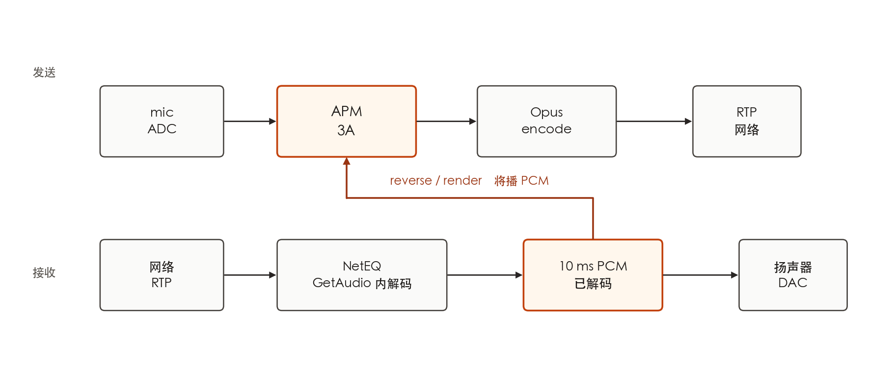
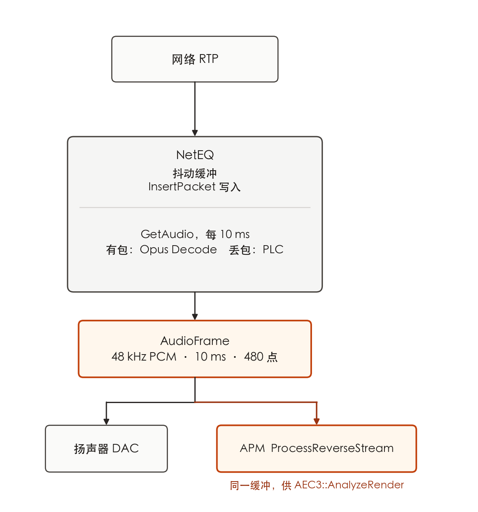

# <div align="center">webrtc_3a.md</div>

只要是在音频算法领域工作，webrtc 就是绝对不容错过的绝佳学习样本。之前自以为掌握了 webrtc 的 aec，ns 算法便掌握了语音前端的精髓，但实际上还远远不够，算法工程师应该要掌握整个音频链路，尤其是那些工程化的有趣技巧。因此在此处重新整理整个链路以及其上的所有算法和技巧。本工程分析采用的算法版本是 aec3，ns，agc2，采样率为 48 khz 以获得尽可能多的算法信息。

---

## 1. 双工总览



两条流必须分清：

| 流 | 方向 | 作用 |
|----|------|------|
| **capture** | mic → 网络 | 近端语音；跑完整 3A |
| **reverse / render** | 将播/已播远参考 → AEC | **只给 AEC 当参考**，不跑 NS/AGC 主链路 |

无 reverse 参考时 AEC 无法消回声（或只能靠弱得多的盲估计）。

---

## 2. 捕获侧：APM 流水线（展开）

源码入口：`AudioProcessingImpl::ProcessCaptureStreamLocked`。  
配置全开、单声道、处理率 = 48 kHz 时的主序：

```
mic PCM
  → §2.1 入 APM / 格式统一
  → §2.2 全带高通（可选，常开）
  → §2.3 电平预调整（可选）
  → §2.4 AEC3::AnalyzeCapture（饱和检测，全带）
  → §2.5 SplitIntoFrequencyBands          # 480 → 3×160
  → §2.2' 分带高通（若配置为 split-band HPF）
  → §2.6 NS::Analyze
  → §2.7 AEC3::ProcessCapture             # ★ 见专节展开
  → §2.6' NS::Process                     # ★
  → §2.8 AGC1（旧路径，可选）
  → §2.5' MergeFrequencyBands             # 3×160 → 480
  → §2.9 AGC2::Process                    # ★
  → §2.10 后处理 / 电平后调整（可选）
  → §2.11 出 APM → 编码器
```

### 2.1 入 APM / 格式统一

| | |
|--|--|
| **模块** | `ProcessStream` → 填 `capture_audio`（`AudioBuffer`） |
| **输入** | 设备 PCM：`int16` 或 `float32`，48 kHz；1 ch 或立体声 |
| **输出** | `float`，平面通道；处理率 48 kHz 时 **1×480**（立体声可先 downmix） |
| **要点** | 块长必须是 10 ms 整数倍；内部一律浮点再往下传 |

### 2.2 高通 `HighPassFilter`

| | |
|--|--|
| **目的** | 去直流、台面 rumble、空调低频；减轻 AEC/NS 负担 |
| **输入** | 全带 `float[C][480]`，或分带后 `float[C][3][160]`（由 `apply_in_full_band` 决定） |
| **输出** | 同形 |
| **实现** | 按通道的 IIR 高通；开 AEC 时 Chrome 路径通常**强制**启用 |
| **与 AEC** | 若增益/滤波在 AEC 前变化，会标 `echo_path_gain_change`，促 AEC 加快再收敛 |

### 2.3 电平预调整 `CaptureLevelsAdjuster`（可选）

| | |
|--|--|
| **输入 / 输出** | 全带 `float[C][480]` |
| **子功能** | 固定预增益；模拟 mic gain 仿真（把「系统音量」喂给后续 AGC） |
| **侧效** | 预增益跳变 → AEC 路径变化标志 |

### 2.4 AEC3：`AnalyzeCapture`（全带）

| | |
|--|--|
| **输入** | 尚未拆带的全带 mic：`float[C][480]` |
| **输出** | 无 PCM 改写；写入内部「麦是否饱和」等状态 |
| **作用** | 饱和时线性滤波不可靠，后续抑制/自适应会改策略 |

### 2.5 三分频拆带 / 合带

| | 拆带 `SplitIntoFrequencyBands` | 合带 `MergeFrequencyBands` |
|--|--|--|
| **输入** | 全带 `float[C][480]` @ 48 kHz | 分带 `float[C][3][160]` |
| **输出** | `float[C][3][160]`（每带等效 16 kHz、10 ms） | 全带 `float[C][480]` |
| **滤波器** | WebRTC `three_band_filter_bank`（分析） | 同组综合 |
| **名义带** | ≈0–8 / 8–16 / 16–24 kHz | — |

AEC3 / NS 的主计算在分带域；AGC2 在合带后的全带上做。

### 2.6 NS `NoiseSuppressor`（★）

经典频域抑制器（非深度学习）。典型子步骤：

1. **Analyze**：对当前分带帧（或 linear AEC 输出）做噪声谱估计更新（语音间隙学噪声）。  
2. **Process**：按频带算抑制增益并乘到信号上。

| | |
|--|--|
| **输入** | AEC 后分带 `float[C][3][160]`；Analyze 也可吃 `linear_aec_output` |
| **输出** | 同形分带 PCM |
| **档位** | config 0–3（约 6 / 12 / 18 / 21 dB 量级） |
| **顺序硬约束** | **必须在 AEC 之后**：否则回声被学进噪声模型，双讲时伤语音 |
| **旁路信息** | 可向 AGC2 提供语音概率 |

### 2.7 AEC3 `ProcessCapture`（★，内部展开见 §2.7.x）

对外 I/O（APM 视角）：

| | |
|--|--|
| **近端输入** | 分带 mic：`float[C][3][160]` |
| **参考** | 已由 §3 reverse 写入的 render 队列（同为分带 10 ms 帧） |
| **输出** | 消回声后的分带 `float[C][3][160]` |
| **可选旁路** | `linear_aec_output`：仅线性滤波后、非线性抑制前的信号（供 NS Analyze） |
| **外部时延提示** | `SetAudioBufferDelay(delay_ms)` → 进入 delay buffer |

AEC3 头文件写明：收 **10 ms 分带帧**，内部再切成 **64 点 block（每带 16 kHz 上 4 ms）** 做核心算法；并部分吸收 render/capture API 调用抖动。

#### 2.7.0 AEC3 时钟与数据形

| 层级 | 块长 | 说明 |
|------|------|------|
| APM / AEC3 帧 | 10 ms = **160** 样点/带 | `FrameBlocker`：10 ms → 若干 4 ms block |
| AEC3 block | **64** 样点/带 @ 16 kHz = **4 ms** | `kBlockSize`；FFT 常用 128 点（含重叠） |
| 全带等价 | 48 kHz 上 10 ms = 480；每 4 ms ≈ 192 全带样点 | 仅帮助建立时间感 |

一次 `ProcessCapture(10 ms)` 内部循环约 **2～3 个** 4 ms block（160/64）。

#### 2.7.1 总结构

```
AnalyzeRender (播放线程，可并发)
  └─ 分带 10 ms render 帧 → SwapQueue → capture 侧取走

ProcessCapture (采集线程)  每个 4 ms block：
  ├─ RenderDelayBuffer::Insert / PrepareCaptureProcessing
  ├─ RenderDelayController (+ EchoPathDelayEstimator)   # 时延估计与对齐
  ├─ BlockProcessor
  │    └─ EchoRemover
  │         ├─ Subtractor          # 线性自适应滤波 + 相减
  │         ├─ AecState            # 收敛 / 双讲 / 路径变化
  │         ├─ ResidualEchoEstimator
  │         ├─ SuppressionGain + SuppressionFilter   # 残余抑制
  │         └─ ComfortNoiseGenerator
  └─ BlockFramer：block 拼回 10 ms 分带帧写出
```

#### 2.7.2 Render 参考队列与 API 抖动

| | |
|--|--|
| **模块** | `AnalyzeRender` + `SwapQueue` + `ApiCallJitterMetrics` |
| **输入** | reverse 分带帧：`float[C_r][3][160]` |
| **输出** | 无业务 PCM；队列里多帧 render 历史 |
| **作用** | 播放线程与采集线程不同步时，用队列吸收 **API call skew**；过/欠载会报 `RenderOverrun` / `Underrun` |

#### 2.7.3 时延估计与对齐（Delay）

回声 = render 经「声卡播缓冲 + DAC + 房间 + ADC + 采缓冲」后的延迟拷贝。对齐错了，后面线性滤波再长也收敛不了。

| 子模块 | 职责 | 输入 → 输出 |
|--------|------|-------------|
| **外部提示** | `SetAudioBufferDelay(ms)` | 宿主测得的播–采缓冲差（ms）→ 写入 delay buffer |
| **`EchoPathDelayEstimator`** | 降采样后做 **matched filter** 相关，估 echo path lag | downsampled render + capture → 样点级时延估计 |
| **`RenderDelayController`** | 把估计变成 buffer 延迟（block 数），带 **hysteresis** 防跳变；可检 clock drift | 估计 → `DelayEstimate`（block） |
| **`RenderDelayBuffer`** | 环形存 render block；`AlignFromDelay` / `AlignFromExternalDelay` 抽「对齐后的」参考 | 原始 render 史 → 对齐后的 `RenderBuffer` + `DownsampledRenderBuffer` |

| 数据形（概念） | |
|--|--|
| **输入** | 当前 capture block：`float[C][3][64]`；render 历史队列 |
| **对齐输出** | 与 capture 同时刻对齐的 render block（及频谱缓冲），供 Subtractor 使用 |
| **时延** | 对齐不稳时 ERLE 上不去 |

#### 2.7.4 线性回声消去 `Subtractor`（自适应滤波）

| | |
|--|--|
| **算法形态** | 分块频域自适应 FIR（PBFDAF / anc工程里面的频域分块就是这个算法），频域乘加代替长时域卷积 |
| **输入** | 对齐后的 render 谱 + 近端 capture block / 谱 |
| **输出** | 回声估计 $\hat y$；误差 $e = d - \hat y$（时域/频域）；可写出 linear output |
| **更新** | 按 ERLE / 双讲 / 饱和等状态调节步长；双讲时降速或冻结，防把近端语音学进滤波器 |

主文件：`subtractor.cc`、`adaptive_fir_filter*.cc`。

#### 2.7.5 状态机 `AecState`

| 监测项 | 用途 |
|--------|------|
| 滤波器收敛 / 发散 | 决定是否信任线性输出、抑制该多狠 |
| 回声路径变化 | 人走动、切蓝牙路由 → 加快再适应或重置部分状态 |
| 双讲倾向 | 与 render/capture 相干、能量比等一起约束自适应与抑制 |
| 透明模式等 | 几乎无回声时少处理，少伤近端 |

#### 2.7.6 残余回声抑制（非线性）

线性滤不掉的部分（非线性喇叭、模型误差、尾声）走抑制：

| 子模块 | 职责 | I/O |
|--------|------|-----|
| **`ResidualEchoEstimator`** | 估各频点残余回声功率 | 线性误差、render 分析、状态 → $\hat E_r(f)$ |
| **`SuppressionGain`** | 逐 bin 算增益（还考虑可听度、掩蔽、饱和、增益变化速率） | 近端功率、残余回声功率、舒适噪声功率 → $G(f)$、高带标量增益 |
| **`SuppressionFilter`** | 把增益乘到误差谱上再 IFFT | 谱域 → 时域 block |

抑制过猛 → 半双工/发虚；过轻 → 漏回声。常靠线性段 ERLE 校准激进程度。

#### 2.7.7 舒适噪声 `ComfortNoiseGenerator`

| | |
|--|--|
| **输入** | 抑制后可能被挖空的频谱；噪声谱估计 |
| **输出** | 填回与房间底噪相近的合成噪声 |
| **目的** | 避免「一抑制就真空」，听感更自然 |

#### 2.7.8 指标（出参）

`GetMetrics()` 常见：`echo_return_loss`、`echo_return_loss_enhancement`（ERLE）、`delay_ms`。排障：ERLE 长期很低 → 对齐或线性滤波未收敛；`delay_ms` 乱跳 → 时延估计不稳。

### 2.8 AGC1（旧路径，可选）

| | |
|--|--|
| **模块** | `AgcManagerDirect` + `GainControl`（模拟+数字压缩） |
| **输入** | 分带域 analyze / process（合带前） |
| **输出** | 改数字压缩增益；可建议系统模拟 mic 音量 |
| **现状** | 新配置默认走 AGC2；与 AGC2 同时开时要看 config 互斥逻辑 |

### 2.9 AGC2 `GainController2`（★）

合带之后的全带处理，内部再拆：

| 子块 | 作用 | 输入 → 输出 |
|------|------|-------------|
| **Input volume controller**（可选） | 根据电平建议/调整系统捕获音量 | 全带帧 + 当前 mic volume → recommended volume |
| **Adaptive digital** | 自适应增益，把语音拉到目标响度 | `float[C][480]` → 同形（已增益） |
| **Limiter** | 防削波 | 同形 |
| **VAD / 语音概率** | 无 NS 时自带；有 NS 时可复用 | 控制自适应快慢 |

| 对外 | |
|--|--|
| **输入** | 合带全带 `float[C][480]` @ 48 kHz |
| **输出** | 同形 |

### 2.10 后处理（可选）

| 模块 | I/O | 作用 |
|------|-----|------|
| `post_filter` | 全带 480 | 实验性滤波 |
| `capture_post_processor` | 全带 480 | 外部注入处理 |
| `CaptureLevelsAdjuster` 后增益 | 全带 480 | 固定后置增益 |

### 2.11 出 APM → 编码器

| | |
|--|--|
| **输出** | 干净近端 PCM：`float` 或 `int16`，48 kHz，**480 / 10 ms** |
| **聚合** | 编码侧常再攒 **960 / 20 ms** 进 Opus |

---

## 3. 反向流：AEC 参考（render / reverse）

参考是 §1 里那块 **10 ms PCM**：`GetAudio` 的出口，即将送进扬声器的同一缓冲。进 APM 之后：

`ProcessReverseStream` / `AnalyzeReverseStream` → Split（若尚未分带）→ `AEC3::AnalyzeRender` → render 队列（§2.7.2）。详见 §5。

| 步骤 | 输入 | 输出 |
|------|------|------|
| 解码/混音后 PCM | 48 kHz，与 capture 处理率一致；10 ms×480/ch | 送 DAC 的同一缓冲 |
| 入 APM reverse | 同上 PCM | render `AudioBuffer` |
| 分带 | 全带 480 | `float[C][3][160]` |
| `AnalyzeRender` | 分带帧 | 推入 AEC3 参考队列（**无「净化后的 reverse PCM」回给业务**） |

**时序**：reverse 调用应贴近真实播放内容；与 capture 的相对延迟靠 §2.7.3 的外部 ms 提示 + 内部 matched filter 共同锁定。无 reverse，AEC3 线性臂没有参考，等于关闭。

---


## 4. 发送侧：编码与打包（APM 之后）

### 4.1 Opus 编码

| | |
|--|--|
| **输入** | 48 kHz PCM，常用 **20 ms = 960 样点/声道**（`int16`/`float`） |
| **输出** | Opus 压缩帧（变长字节），内部仍按 48 kHz 时钟 |
| **常用配置** | bitrate 视场景；可开 in-band FEC（LBRR）、DTX |

### 4.2 RTP 打包

| | |
|--|--|
| **输入** | Opus payload |
| **输出** | RTP 包（RFC 3550 + Opus payload RFC 7587）：序号、时间戳、SSRC、可选 RED |
| **时钟** | Opus/RTP 时间戳通常按 48 kHz 计 |

---

## 5. 接收侧：GetAudio 解出 PCM 再播放



`InsertPacket` 把 RTP 载荷放进 NetEQ 的抖动缓冲。播放线程每 10 ms 调用 `GetAudio`：有包时在这次调用里做 Opus 解码，丢包时走 PLC。返回的 `AudioFrame` 是 48 kHz PCM（单声道 480 点）。这份 PCM 送扬声器，同一缓冲交给 `ProcessReverseStream`，作为 §3 的 reverse 参考。

NetEQ 同时做抖动缓冲、丢包隐藏，配合 FEC/NACK，也可参与音画同步。接收侧不再跑捕获 3A（远端已在对端处理过）；本端取流、播放，并为本地 AEC 提供参考。

---

## 6. 端到端数据格式一览（48 kHz 单声道）

| 阶段 | 典型块 | 格式 | 样点数/块 |
|------|--------|------|-----------|
| mic 采集 | 驱动相关 | `int16`/`float` PCM | ≥480 的整数倍 |
| APM 入/出 | 10 ms | `AudioBuffer` float | **480** |
| APM 分带 | 10 ms | 3×band float | **3×160** |
| AEC3 block | 4 ms | 每带 float | **64**（16 kHz 带率） |
| AEC 参考 | 10 ms | float PCM → render 队列 | **480** → 拆带 **3×160** |
| Opus 编码 | 20 ms | PCM → Opus bytes | **960** |
| RTP | 1 packet | Opus + RTP header | — |
| NetEQ 拉流 | 10 ms | PCM | **480** |
| 扬声器 | 设备缓冲 | PCM | 设备相关 |

立体声时每通道各自 480/960；APM 常在 AEC 前 downmix 成单声道处理（多通道 capture 为配置项）。

---

## 7. 延迟与顺序要点

1. **顺序不能乱**：高通 → AEC → NS → AGC。NS 在 AEC 前会把回声学进噪声模型；AGC 在 AEC 前会改回声路径增益。  
2. **APM 10 ms vs Opus 20 ms**：处理按 10 ms；编码常按 20 ms 组帧，多 10 ms 组帧延迟。  
3. **reverse 时延**：蓝牙 / USB 声卡缓冲变化大，`stream_delay_ms` 不准时双讲与残余回声都会变差。  
4. **口到耳**：采集 + APM + Opus 20 ms + 网络 + NetEQ 取流播放；NetEQ 缓冲随网络变长，是通话「发闷/变慢」的主因之一。

---

## 8. 源码锚点（libwebrtc）

| 组件 | 路径（相对 webrtc 源码根） |
|------|---------------------------|
| APM 主循环 | `modules/audio_processing/audio_processing_impl.cc` → `ProcessCaptureStreamLocked` |
| 分带缓冲 | `modules/audio_processing/audio_buffer.cc` |
| 三分频 | `modules/audio_processing/three_band_filter_bank.*` |
| AEC3 入口 | `modules/audio_processing/aec3/echo_canceller3.*`、`modules/audio_processing/aec3/block_processor.*` |
| 时延对齐 | `modules/audio_processing/aec3/render_delay_buffer.*`、`modules/audio_processing/aec3/render_delay_controller.*`、`modules/audio_processing/aec3/echo_path_delay_estimator.*` |
| 线性滤波 | `modules/audio_processing/aec3/subtractor.*`、`modules/audio_processing/aec3/adaptive_fir_filter*.*` |
| 状态 / 抑制 | `modules/audio_processing/aec3/aec_state.*`、`modules/audio_processing/aec3/suppression_gain.*`、`modules/audio_processing/aec3/suppression_filter.*`、`modules/audio_processing/aec3/residual_echo_estimator.*` |
| 舒适噪声 | `modules/audio_processing/aec3/comfort_noise_generator.*` |
| NS | `modules/audio_processing/ns/` |
| AGC2 | `modules/audio_processing/agc2/` |
| NetEQ | `modules/audio_coding/neteq/` |

配置入口：`api/audio/audio_processing.h` 中 `AudioProcessing::Config`；AEC3 细参在 `api/audio/echo_canceller3_config.h`。
