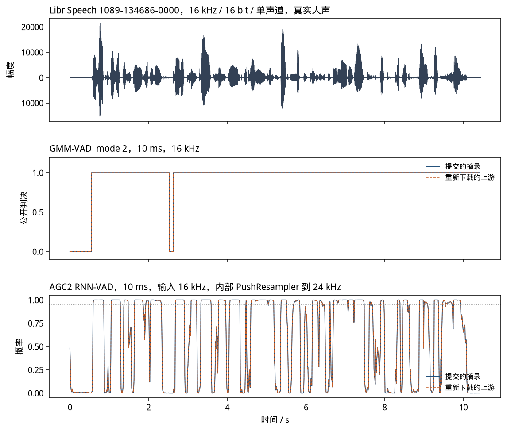
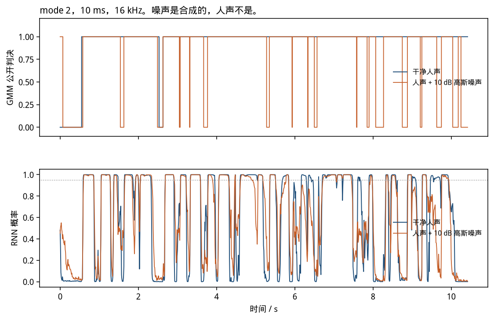
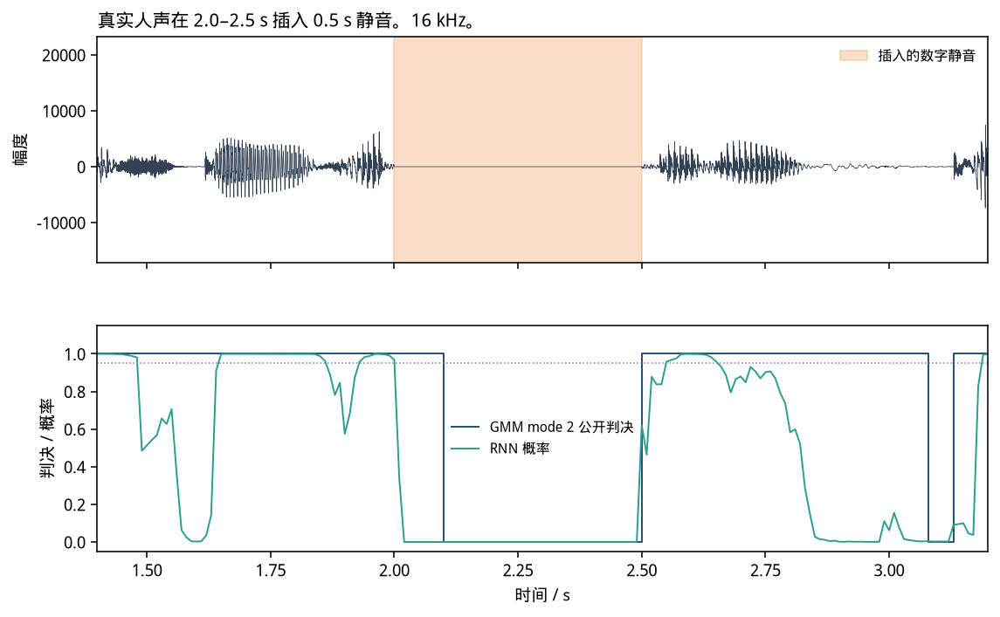
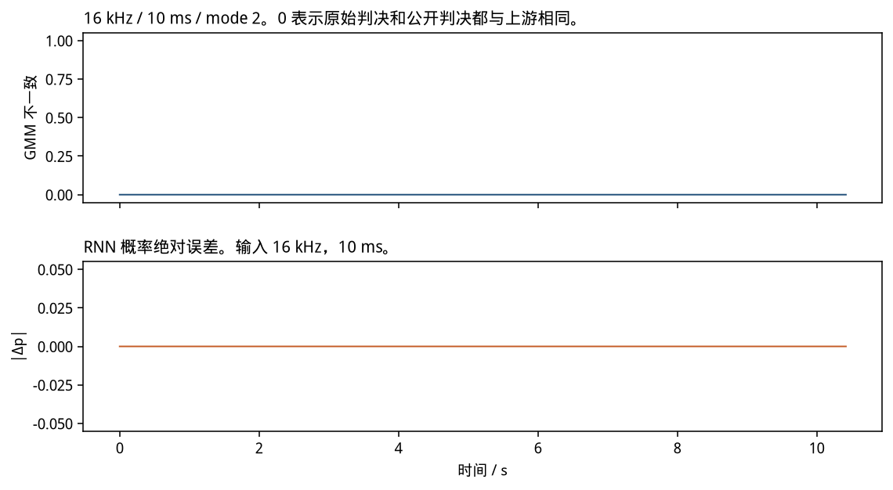

# VAD 仿真结果报告

本报告只汇总已经跑过的 GMM-VAD 与 AGC2 RNN-VAD 对照。图、逐帧表、输入和配置都在 `temp/vad/` 里。`doc/image/` 没有移动，这里用的是当时图的副本。

合入前核对用。不需要时可以删掉整个 `temp/`。

## 1. 材料从哪来

| 内容 | 路径 | 是不是当时那次运行直接留下的 |
|------|------|------------------------------|
| 四张对比图 | [retained/figures/](retained/figures/) | 是。2026-11-09 02:44 UTC 的 `align_vad.py` 写入，与当时 `doc/image/` 字节相同 |
| 一行汇总 | [retained/align_summary.txt](retained/align_summary.txt) | 是。同一次运行 |
| 缺失说明 | [retained/MISSING.txt](retained/MISSING.txt) | 是说明，不是补写的旧日志 |
| 逐帧输出和误差 | [rerun/](rerun/) | 否。09:36 UTC 用 02:42–02:44 留下的可执行文件和同一批 PCM 再跑。没有重新下载、没有重新编译 |
| 输入 WAV / PCM / 配置 / 校验和 | [inputs/](inputs/) | 输入是当时用的文件复制进来的。2026-11-09 核对过：PCM 与 WAV 按 [inputs/config.txt](inputs/config.txt) 的规则逐样本相同 |

02:44 那次的完整标准输出没有留下。`align_vad.py` 当时也不写逐帧文件。所以逐帧表不能假装是旧日志，只能标成补跑。补跑的汇总数和 02:44 打印一致，见第 4 节。

## 2. 输入、种子和版本

真实人声是 LibriSpeech test-clean 语句 `1089-134686-0000`，CC BY 4.0。本目录副本：

[inputs/1089-134686-0000.wav](inputs/1089-134686-0000.wav)

16 kHz、16 bit、单声道、166960 点、10.435 s。SHA-256 与 [retained/align_summary.txt](retained/align_summary.txt) 相同：`e0bb45200ea542afe89f10958c629b19af07a5f30786021e24b93d907582c231`。语料没有逐帧语音/静音标注，下面的帧数不是准确率。

实际送进两个程序的 PCM 在 [inputs/pcm/](inputs/pcm/)。规则、种子 `20261109`、噪声标准差 `483.37210429488954`、RMS `1528.5568069603091` 写在 [inputs/config.txt](inputs/config.txt)。校验和在 [inputs/checksums.sha256](inputs/checksums.sha256)。

参考源码钉在 [inputs/SOURCE_PIN.txt](inputs/SOURCE_PIN.txt)：

- WebRTC `eeb7e6beb2e20c5a273922fdf22b75a75cc28ad5`（2026-11-07）
- Chromium `third_party`（PFFFT 与 RNNoise 权重）`63d42f6e6a54c9463fcb599001ca81ff2fd3dc8e`

学习版和原版编的是同一批算法文件。原版是脚本把这些文件再下载一遍后另编的。构建垫片（DCHECK 按 Release 丢掉、`__builtin_cpu_supports`、`posix_memalign`、`-include cstring`）的副本在 [inputs/build_adaptations.md](inputs/build_adaptations.md)。没有改 GMM 门限、RNN 权重或滤波器系数。两边用同一套垫片，所以 SIMD 核的选择一致。

## 3. 对比图

图都在 `retained/figures/`。虚线是重新下载后编译的上游，实线是仓库里的摘录。差图为零。

### 3.1 真实语音



上图是原始波形。中间是 GMM，16 kHz、10 ms、mode 2 的公开 0/1。下图是 RNN，输入同样是 16 kHz、10 ms，内部用摘下来的 `PushResampler` 变到 24 kHz，并每 1500 ms 清一次 GRU。横线是 0.95，只用来看门限，不是语料标注。

GMM 在开头约 0.6 s 保持非语音，之后大部分时间判为语音，大约 2.6 s 附近有一小段回到 0。1043 帧里公开判决为 1 的有 978 帧。mode 越严，这个数越小：mode 0 和 1 都是 1024，mode 3 是 887。数字在 [rerun/summary.csv](rerun/summary.csv)。

RNN 跟着能量起伏，安静段概率掉下去，并不整段贴在 1。1043 帧平均概率 0.614，最大 0.999986，最小约 `7.0e-5`，没有一帧精确为 0，其中 519 帧 ≥ 0.95。全 0 输入的 100 帧概率都是 0，对应静音门把 GRU 清掉。

### 3.2 加噪



噪声是种子 `20261109` 的高斯噪声，按 10 dB 加到同一条人声上，再限幅到 int16。人声不是合成的，噪声是合成的。

同一 GMM 设置（mode 2、10 ms、16 kHz）下，公开语音帧从 978 降到 853。RNN 里 ≥ 0.95 的帧从 519 降到 399。更严的 GMM mode 3 在加噪后是 781。这只说明加噪后两条检测器都更少把帧标成语音，不能当成误检率。

### 3.3 插入的静音



在真实语音的 2.0 s 处插入 0.5 s 全 0，前后仍是原录音。图的时间轴放大到 1.4–3.2 s。GMM mode 2 的公开判决和 RNN 概率都画在下半幅。插入段是数字静音，不是另一段录音。pause16、10 ms、mode 2：1093 帧里公开语音帧 993。RNN 里 ≥ 0.95 的帧是 482。

### 3.4 逐帧差



上图是 16 kHz、10 ms、mode 2：原始判决和公开判决只要有一项与上游不同就记 1。整段是 0。下图是同一条语音上 RNN 概率的绝对误差，整段是 0。其余条件的总数在下一节，不另画。

## 4. 逐帧一致性

补跑日志：[rerun/logs/rerun.log](rerun/logs/rerun.log)。总表：[rerun/summary.csv](rerun/summary.csv)。

GMM 每个条件三份文件：`rerun/gmm/<条件>.learn.txt`、`.ref.txt` 是程序 stdout（`frame raw public`），`.error.csv` 把两边的原始返回和公开 0/1 并在一起。原始返回可以大于 1，那是拖尾编码；`WebRtcVad_Process` 把大于 0 收成 1。两列都比过。

RNN 同样三份。`.learn.txt` / `.ref.txt` 是十六进制浮点。`.error.csv` 含绝对误差，以及两边是否同时跨过 0.95。概率一致指十六进制浮点相同，不是只看门限。

GMM 60 组（16 kHz 四条信号 × 10/20/30 ms × mode 0–3，外加 8/32/48 kHz 的 10 ms 与 30 ms、mode 0 与 3）。每一组 `raw_mismatch=0` 且 `public_mismatch=0`。

RNN 6 组（`speech16`、`silence16`、`pause16`、`noise10db16`、`decimate8`、`hold48`，都是 10 ms）。每一组最大绝对误差 0、平均绝对误差 0、非零误差帧数 0、0.95 门限不一致帧数 0。`hold32` 只跑了 GMM，和 `align_vad.py` 的用例一样，没有 RNN。

非法采样率 22050 Hz、10 ms、mode 0：学习版和原版退出码都是 2。记录在 [rerun/logs/gmm_invalid_rate_learn.txt](rerun/logs/gmm_invalid_rate_learn.txt) 和 [rerun/logs/gmm_invalid_rate_ref.txt](rerun/logs/gmm_invalid_rate_ref.txt)。

抽查一条原始输出，16 kHz 人声、RNN 第 0 帧两边都是 `0x1.ed6dcap-2`，绝对误差 0：

[rerun/rnn/speech16_16000Hz_10ms.error.csv](rerun/rnn/speech16_16000Hz_10ms.error.csv)

GMM 同一段、mode 2 的前两帧原始判决和公开判决都是 0，且两边相同：

[rerun/gmm/speech16_16000Hz_10ms_mode2.error.csv](rerun/gmm/speech16_16000Hz_10ms_mode2.error.csv)

## 5. 局限和缺失

- 没有 02:44 的完整终端日志。见 [retained/MISSING.txt](retained/MISSING.txt)。逐帧文件是 09:36 的补跑，不是把旧日志重写出来的。
- 没有编一整份未裁剪的 libwebrtc。原版是 VAD 相关源文件再下载后，用同一套垫片编译。垫片清单见 [inputs/build_adaptations.md](inputs/build_adaptations.md)。
- 8 kHz 是隔点抽取，32/48 kHz 是样点保持。它们只用来走进对应采样率分支，不是这条录音的原始采样率。
- 没有逐帧人工标注，因此没有准确率、漏检或误检。
- 增益曲线、噪声底和限幅器没有跑。RNN 图上的 0.95 只是对照用的门限。
- `SpeechProbabilityBuffer` 不在这次 `Process` 路径上，图里没有它。

## 6. 复现

依赖：CMake、C/C++ 编译器、Python 3、NumPy、Matplotlib。完整对照会重新下载上游并编译，不使用本目录里的 PCM 副本：

```bash
python3 sim/vad/align_vad.py
```

本目录的逐帧文件对应的调用是：

```bash
gmm_learn <inputs/pcm/name.s16> <rate> <frame_ms> <mode>
rnn_learn <inputs/pcm/name.s16> <rate>
```

学习版和原版各跑一次。参数以 [inputs/config.txt](inputs/config.txt) 为准。
